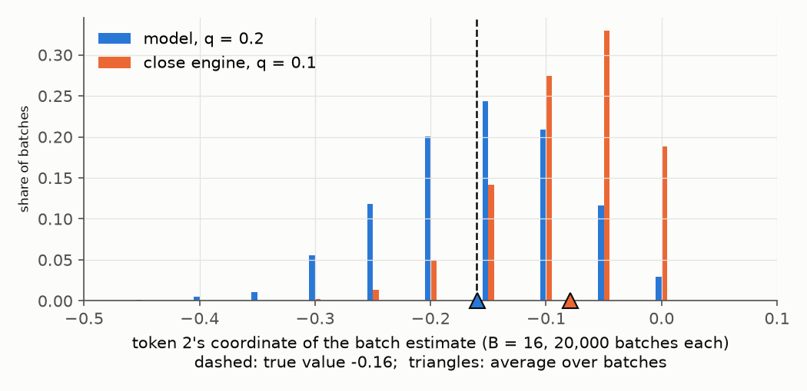
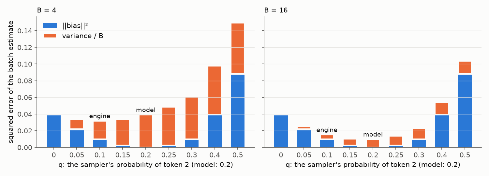

# Bias and variance of the policy gradient

## Summary

The policy gradient is estimated from a sampled batch. The estimate's error has two parts. Bias is the offset of
its average from the true gradient. Variance is its scatter around that average. Growing the batch shrinks only the
variance: bias is paid once, variance is paid in proportion to one over the batch size. Every algorithm is a choice
of advantage and per-token weight that lowers one part by raising the other, and which choice is best depends on
the batch size.

- A baseline lowers variance and adds no bias, as long as the model wrote the tokens (section 5).
- When something else wrote them, an inference engine or the model a few updates ago, there is no free fix.
  Ignoring the mismatch costs bias in proportion to the probability mass that moved, which is bounded. Correcting it
  with importance weights costs variance in proportion to the squared weights, which is not (section 6).
- A cap on the weight (TIS, CISPO) bounds that variance at the price of some bias. The best cap grows with the
  batch size (6.4).
- Trust regions (PPO, DPPO, GSPO) drop tokens that moved too far. That is bias on those tokens, accepted so that
  the batch's prediction of the next step stays honest (section 7).
- Unbiased is not better. At a batch of 16 the lowest error on both toy samplers belongs to a biased estimator
  (sections 4 and 6.3).

Everything is worked on a toy with one position and three tokens, where the true gradient is exact and every
number can be checked by hand.

## 1. The question

RL for language models estimates the policy gradient from a sampled batch. The tokens in the batch were rarely
written by the model being trained. They come from an inference engine that is numerically different from the
trainer [[1]](#ref-1)[[2]](#ref-2), and the trainer takes several steps on one batch, so by the second step its
parameters are no longer the ones that wrote the tokens [[14]](#ref-14). Importance sampling (IS), truncated IS
(TIS), CISPO, PPO, GSPO and DPPO each modify the per-token weight to cope with that; GRPO and RLOO modify the
advantage. This post measures, on a toy where everything is exact, how far each estimator lands from the true
gradient, split into bias and variance.

## 2. The update

Let $z \in \mathbb{R}^V$ be the logits at one position, $p = \operatorname{softmax}(z)$ the trained model's
distribution, and $p_{\text{engine}}$ the distribution that actually wrote the tokens (section 6 says what it is in
each method). For a sampled token $y$ with
one-hot $e_y$, advantage $A$ and per-token weight $w$, the policy-gradient update on the logits is [[3]](#ref-3)

$$\text{dlogits} = w\,A\,(p - e_y).$$

This is a loss gradient ($p - e_y = \nabla_z[-\log p_y]$), so training subtracts it. The reward enters only through
$A$. Plain REINFORCE has $w = 1$; every correction method below is a choice of $w$. A batch of $B$ responses of $S$
tokens averages this over all $BS$ tokens.

## 3. The true gradient

The true gradient is the update from section 2, averaged over which token gets written, each weighted by how often
the model writes it. By the policy gradient identity this equals $-\nabla_z J$, the gradient of the average reward
$J = \sum_y p_y\, r_y$ in loss sign [[3]](#ref-3)[[4]](#ref-4):

$$g = \sum_y p_y \cdot r_y\,(p - e_y) \qquad (w = 1,\ A = r_y).$$

Every method below is an estimate of $g$. The toy has one position, three tokens, and only token 2 is rewarded:

```python
p = [0.5, 0.3, 0.2]    # model
r = [0, 0, 1]          # reward if token k is written
```

| $y$ | $p_y$ | $A = r_y$ | $p - e_y$ | $p_y \cdot A \cdot (p - e_y)$ |
|---|---|---|---|---|
| 0 | 0.5 | 0 | (−0.5, 0.3, 0.2) | (0, 0, 0) |
| 1 | 0.3 | 0 | (0.5, −0.7, 0.2) | (0, 0, 0) |
| 2 | 0.2 | 1 | (0.5, 0.3, −0.8) | (0.10, 0.06, −0.16) |
| | | | **sum** | **$g$ = (0.10, 0.06, −0.16)** |

The weight $p_y$ is how often the model itself writes each token. That is what breaks when another model writes the
tokens (section 6). A real model can't sum over all $V^S$ responses, so it averages $B$ samples instead.

## 4. Bias and variance

Call the update of one sampled token a row, $x = w\,A\,(p - e_y)$, and the average of $B$ rows $\hat g_B$. In
section 3's table only the $y = 2$ row is nonzero. Call it $v$:

$$\begin{gathered}
v = p - e_2 = (0.5,\ 0.3,\ -0.8), \qquad g = 0.2\,v = (0.10,\ 0.06,\ -0.16), \\
\|v\|^2 = 0.25 + 0.09 + 0.64 = 0.98.
\end{gathered}$$

With $q$ the probability that a sampled token is 2, one row is $x = v$ with probability $q$ and $0$ otherwise:
a Bernoulli($q$) scaled by $v$. A batch average is $v$ times the fraction of 2s it drew.

The model writes token 2 at $q = p_2 = 0.2$. Suppose instead a sampler that writes it half as often, $q = 0.1$;
section 6 calls it the close engine. Draw many batches of 16 from each:



*Figure 1: where batches of 16 land, 20,000 from each sampler. Dashed is $g$. Every figure draws token 2's
coordinate of the estimate; every number in the tables is for the full vector.*

Both spread around a center. The model's center is $g$; the engine's sits short of it. More batches tighten the
spread but never move a center. The spread is variance; the offset of the center is bias:

**Error.** The error of the estimator is the mean squared miss over batches, $\mathbb{E}\,\|\hat g_B - g\|^2$. It
decomposes into bias and variance [[5]](#ref-5):

$$\mathbb{E}\,\|\hat g_B - g\|^2 = \underbrace{\|\mathbb{E}[\hat g_B] - g\|^2}_{\text{bias}^2} + \underbrace{\mathbb{E}\,\|\hat g_B - \mathbb{E}[\hat g_B]\|^2}_{\text{variance}}.$$

:::note bias–variance decomposition
For any estimator $\hat\theta$ of a target $\theta$, with $m = \mathbb{E}[\hat\theta]$:

$$\hat\theta - \theta = (\hat\theta - m) + (m - \theta).$$

Square both sides, $\|a + b\|^2 = \|a\|^2 + 2\,a\cdot b + \|b\|^2$, and take expectations. The constant
$m - \theta$ comes out of the cross term, and what is left of it is zero:

$$\mathbb{E}\big[2\,(\hat\theta - m)\cdot(m - \theta)\big] = 2\,(m - \theta)\cdot\big(\mathbb{E}[\hat\theta] - m\big) = 0.$$

So

$$\mathbb{E}\,\|\hat\theta - \theta\|^2 = \underbrace{\mathbb{E}\,\|\hat\theta - m\|^2}_{\text{variance}} + \underbrace{\|m - \theta\|^2}_{\text{bias}^2}.$$

Bias is systematic: the estimator's average is off target, and more samples do not move it. Variance is random
fluctuation around that average; for a mean of $B$ independent samples it is $\operatorname{Var}(\text{one sample})/B$.
The two trade off: a biased estimator with small variance can beat an unbiased one with large variance, and which
wins depends on $B$. Here $\hat\theta = \hat g_B$ and $\theta = g$ [[5]](#ref-5).
:::

A batch averages $B$ independent rows, so $\mathbb{E}[\hat g_B] = \mathbb{E}[x]$ and
$\operatorname{Var}(\hat g_B) = \operatorname{Var}(x)/B$:

$$\mathbb{E}\,\|\hat g_B - g\|^2 = \|\mathbb{E}[x] - g\|^2 + \frac{\operatorname{Var}(x)}{B}.$$

Only $\operatorname{Var}(x)/B$ shrinks with $B$. In the toy only two rows occur, $v$ with probability $q$ and $0$
otherwise, so

$$\mathbb{E}[x] = q\,v, \qquad \operatorname{Var}(x) = {{\|v\|^2\, q(1-q) @@ the variance of a coin that lands v with probability q and 0 otherwise: q(1−q), scaled by ‖v‖² = 0.98}}.$$

| | model, $q = 0.2$ | engine, $q = 0.1$ |
|---|---|---|
| $\mathbb{E}[x] = q\,v$ | $0.2\,v$ = (0.10, 0.06, −0.16) | $0.1\,v$ = (0.05, 0.03, −0.08) |
| bias $= \mathbb{E}[x] - g$ | (0, 0, 0) | (−0.05, −0.03, +0.08) $= -0.1\,v$ |
| $\|\text{bias}\|^2$ | 0 | $0.05^2 + 0.03^2 + 0.08^2 = 0.0098$ |
| $\operatorname{Var}(x) = \|v\|^2\, q(1-q)$ | $0.98 \cdot 0.2 \cdot 0.8 = 0.157$ | $0.98 \cdot 0.1 \cdot 0.9 = 0.088$ |
| error $= \|\text{bias}\|^2 + \operatorname{Var}(x)/B$ | $0.157 / B$ | $0.0098 + 0.088 / B$ |
| at $B = 16$ | 0.0098 | $0.0098 + 0.0055 = 0.0153$ |

The model's bias is 0 because it writes token 2 at exactly the rate $g$ weights the $y = 2$ row, $q = p_2$
(section 3). Bias appears when that match breaks: $y$ drawn from a different distribution than $p$, as with the
engine, or the row changed ($w \ne 1$, $A$ rescaled).

Only the variance term depends on $B$:

| $B$ | model, $0.157/B$ | engine, $0.0098 + 0.088/B$ |
|---|---|---|
| 4 | 0.039 | 0.032 |
| 16 | 0.0098 | 0.0153 |
| 256 | 0.0006 | 0.0101 |

The model's error goes to 0. The engine's stops at its $\|\text{bias}\|^2$. Yet below $B = 7$ the engine has the
smaller error, because its variance is lower and at a small batch variance is most of the error.



*Figure 2: $\|\text{bias}\|^2 = 0.98\,(q - 0.2)^2$ and $\operatorname{Var}(x)/B = 0.98\,q(1-q)/B$ as the sampler's
probability of token 2 varies. The engine at $q = 0.1$ beats the model at $B = 4$ and loses at $B = 16$.*

The engine's variance is lower because at $q = 0.1$ most rows are $0$, so they agree with each other more than the
model's do; $q(1-q)$ shrinks toward either end. But they agree on $0.1\,v$, not $g$.

This is the trade the rest of the post is about. Bias is paid once: no batch size moves the center. Variance is
paid $1/B$. So a biased estimator with less variance wins at small $B$ and loses at large $B$, and the crossover is
a property of the pair, here $B = 7$. Section 5 lowers $\operatorname{Var}(x)$ without adding bias. Every method in
section 6 lowers one term by raising the other, and the right choice moves with $B$.

## 5. Baseline: less variance, no bias

A baseline subtracts the same $b$ from every reward. A constant added to every reward cannot favor any token on
average, so the average row is unchanged. Each individual row does change, and that is where the variance goes.

Replace $A = r_y$ with $A = r_y - b$ and multiply out the row:

$$(r_y - b)\,(p - e_y) = \underbrace{r_y\,(p - e_y)}_{\text{row without baseline}} \;-\; \underbrace{b\,(p - e_y)}_{\text{what the baseline subtracts}}.$$

The subtracted piece is not a constant: it depends on which $y$ was drawn and changes sign, and in proportion to
how often each $y$ is drawn the pieces cancel.

:::note a constant reward moves nothing: every step
The toy's $p = (0.5, 0.3, 0.2)$, reward $2$ whatever is drawn, so $A = 2$ for every row.

| | $y = 0$ | $y = 1$ | $y = 2$ |
|---|---|---|---|
| how often, $p_y$ | 0.5 | 0.3 | 0.2 |
| $e_y$ | (1, 0, 0) | (0, 1, 0) | (0, 0, 1) |
| $p - e_y$ | (−0.5, 0.3, 0.2) | (0.5, −0.7, 0.2) | (0.5, 0.3, −0.8) |
| row $= 2\,(p - e_y)$ | (−1.0, 0.6, 0.4) | (1.0, −1.4, 0.4) | (1.0, 0.6, −1.6) |
| $p_y \times$ row | (−0.50, 0.30, 0.20) | (0.30, −0.42, 0.12) | (0.20, 0.12, −0.32) |

Sum of the last line, coordinate by coordinate: $-0.50 + 0.30 + 0.20 = 0$, $0.30 - 0.42 + 0.12 = 0$,
$0.20 + 0.12 - 0.32 = 0$. Each row pushes its own token up (training subtracts the row) and the others down; token 0
gets a push of $-1.0$ often, token 2 a push of $-1.6$ rarely, and each token's upward pushes equal what the other
rows push it down. A baseline is this table with $-b$ in place of $2$.
:::

The toy, $r = (0, 0, 1)$, without a baseline and with $b = 0.2$:

| $y$ | $p_y$ | $p - e_y$ | $A = r_y$ | row $= A\,(p - e_y)$ | $A = r_y - 0.2$ | row $= A\,(p - e_y)$ | subtracted $= 0.2\,(p - e_y)$ | $p_y \times$ subtracted |
|---|---|---|---|---|---|---|---|---|
| 0 | 0.5 | (−0.5, 0.3, 0.2) | 0 | (0, 0, 0) | −0.2 | (0.10, −0.06, −0.04) | (−0.10, 0.06, 0.04) | (−0.05, 0.03, 0.02) |
| 1 | 0.3 | (0.5, −0.7, 0.2) | 0 | (0, 0, 0) | −0.2 | (−0.10, 0.14, −0.04) | (0.10, −0.14, 0.04) | (0.03, −0.04, 0.01) |
| 2 | 0.2 | (0.5, 0.3, −0.8) | 1 | (0.50, 0.30, −0.80) | 0.8 | (0.40, 0.24, −0.64) | (0.10, 0.06, −0.16) | (0.02, 0.01, −0.03) |
| | | | | **avg (0.10, 0.06, −0.16) $= g$** | | **avg (0.10, 0.06, −0.16) $= g$** | | **sum (0, 0, 0): bias the baseline adds** |
| | | | | **$\operatorname{Var}(x)$ 0.157** | | **$\operatorname{Var}(x)$ 0.103** | | |

The average row is $g$ in both columns. The bias the baseline adds is the weighted sum of what it subtracts (last
column), and that is zero because $e_y$ lands on each token as often as $p$ says: $\mathbb{E}[e_y] = p$
[[3]](#ref-3)[[6]](#ref-6). The rows sit closer to the unchanged average, so lower variance.


*Figure 3: 20,000 batches of 16, model sampling itself, token 2's coordinate of the batch estimate. Both center on
the true value; $b = 0.2$ is narrower.*

## 6. When the model did not write the tokens

Sections 4 and 5 assumed $y \sim p$. In training the tokens come from a distribution that differs from $p$ in one
of two ways. Both show up as the same thing in the row: a ratio $\rho_y = p_y / p_{\text{engine},y}$ that is not 1.

| mismatch | what wrote the tokens | why it differs from $p$ | methods whose ratio is against it |
|---|---|---|---|
| engine vs trainer | the inference engine, same parameters | different kernels, precision and batching [[1]](#ref-1) | IS, TIS, DPPO; REINFORCE ignores it |
| old vs new parameters | the trainer at $\theta_{\text{old}}$, the parameters when the batch was sampled | several optimizer steps are taken on one batch; after the first, $\theta$ has moved [[14]](#ref-14) | PPO, CISPO, GSPO |

The toy needs only $p$ and the distribution that wrote the tokens, so one symbol serves both: $p_{\text{engine}}$
below is the engine for the first group and $p_{\theta_{\text{old}}}$ for the second. The arithmetic is identical.
The two mismatches differ in what happens next, which is section 7. Two samplers, $b = 0$:

```python
p     = [0.5,  0.3,  0.2 ]    # model
close = [0.6,  0.3,  0.1 ]    # writes token 2 half as often
far   = [0.69, 0.30, 0.01]    # almost never writes token 2
```

### 6.1 Two distances between engine and model

The engine's error on each token can be read as a difference or as a ratio. The far engine:

| token $k$ | $p_k$ | $p_{\text{engine},k}$ | difference $p_k - p_{\text{engine},k}$ | ratio $p_k / p_{\text{engine},k}$ |
|---|---|---|---|---|
| 0 | 0.50 | 0.69 | −0.19 | 0.72 |
| 1 | 0.30 | 0.30 | 0 | 1.0 |
| 2 | 0.20 | 0.01 | +0.19 | 20 |

**Total variation** adds up the differences [[9]](#ref-9):

$$\mathrm{TV} = \tfrac{1}{2}\textstyle\sum_k |p_k - p_{\text{engine},k}|,$$

half because each move is counted where it leaves and where it lands. It is the mass that moved, so it never
exceeds 1.

**Chi-squared** is the variance of the ratio. The ratio is the importance weight, $w_k = p_k / p_{\text{engine},k}$
[[10]](#ref-10)[[12]](#ref-12). Under the engine it is random, averages to 1 (since
$\sum_k p_{\text{engine},k} \cdot p_k / p_{\text{engine},k} = 1$), and its variance is [[11]](#ref-11)

$$\operatorname{Var}_{p_{\text{engine}}}(w) = \mathbb{E}[w^2] - 1 = \sum_k \frac{p_k^2}{p_{\text{engine},k}} - 1 = \chi^2(p \,\|\, p_{\text{engine}}).$$

| | close engine, (0.6, 0.3, 0.1) | far engine, (0.69, 0.30, 0.01) |
|---|---|---|
| TV $= \tfrac12 \sum_k \lvert p_k - p_{\text{engine},k} \rvert$ | $\tfrac12 (0.1 + 0 + 0.1) = 0.10$ | $\tfrac12 (0.19 + 0 + 0.19) = 0.19$ |
| weights $w$ | (0.83, 1.0, 2.0) | (0.72, 1.0, 20) |
| $\chi^2 = \sum_k p_{\text{engine},k}\, w_k^2 - 1$ | $0.6 \cdot 0.83^2 + 0.3 \cdot 1 + 0.1 \cdot 2^2 - 1 = 0.12$ | $0.69 \cdot 0.72^2 + 0.30 \cdot 1 + 0.01 \cdot 20^2 - 1 = 3.66$ |

TV sees the difference, bounded by the mass that exists. $\chi^2$ sees the ratio squared, unbounded as
$p_{\text{engine},2} \to 0$; in the far column, token 2's term is nearly all of $\chi^2$.

TV sets the bias of ignoring the mismatch; $\chi^2$ sets the variance of correcting it. From the close sampler to
the far one, TV doubles and $\chi^2$ grows thirtyfold. 6.2 shows both costs on batches; 6.4 puts a cap between them.

### 6.2 Three weights

Far engine, $b = 0$. The engine produces the rewarded token, token 2, in 1 row out of 100; the model would produce
it in 20. Only token 2's row is nonzero, and it is $w_2\,${{$v$ @@ v = p − e_2 = (0.5, 0.3, −0.8), the y = 2 row of section 3's table; defined in section 4}}, so a batch's estimate is
$v$ times its token-2 count, times $w_2$, over 16. The truth is {{$g = 0.2\,v$ @@ section 3's table: only the y = 2 row is nonzero, weighted by p_2 = 0.2}}. Seven batches of 16, with one token-2 row among
them, under three choices of $w_2$:

| batch | token-2 rows | REINFORCE, $w_2 = 1$ | IS, $w_2 = 20$ | TIS, $w_2 = 2$ |
|---|---|---|---|---|
| 1 | 0 | 0 | 0 | 0 |
| 2 | 0 | 0 | 0 | 0 |
| 3 | 1 | $\tfrac{1}{16}\,v = 0.31\,g$ | $\tfrac{20}{16}\,v = 6.25\,g$ | $\tfrac{2}{16}\,v = 0.63\,g$ |
| 4 | 0 | 0 | 0 | 0 |
| 5 | 0 | 0 | 0 | 0 |
| 6 | 0 | 0 | 0 | 0 |
| 7 | 0 | 0 | 0 | 0 |
| average over many batches | 0.16 of 16 | $0.01\,v = 0.05\,g$ | $0.2\,v = g$ | $0.02\,v = 0.10\,g$ |

- **REINFORCE** counts the row once. Even the batch that has it delivers a third of the truth; the rest deliver
  nothing. The average settles at a twentieth of the truth. Bias.
- **IS** counts the row 20 times, which is exactly how under-represented it is. The average settles on the truth.
  But no batch is near it: six say zero, one says six times too much. Variance.
- **TIS** [[13]](#ref-13)[[1]](#ref-1) counts it twice. A tenth of the truth on average, delivered by one batch
  in seven: most of REINFORCE's bias with a little of IS's variance.

The mismatch does not go away; $w_2$ only chooses whether it shows up as consistently short or as widely scattered.
In the formulas of section 4, with $q = p_{\text{engine},2} = 0.01$:

$$\begin{gathered}
\mathbb{E}[x] = q\,w_2\,v, \qquad \text{bias} = \mathbb{E}[x] - g = (q\,w_2 - p_2)\,v, \\
\operatorname{Var}(x) = w_2^2\,\|v\|^2\,q(1-q), \qquad \text{error} = \|\text{bias}\|^2 + \frac{\operatorname{Var}(x)}{B},
\end{gathered}$$

| | $w_2$ | $q\,w_2$ | $\|\text{bias}\|^2 = 0.98\,(q\,w_2 - 0.2)^2$ | $\operatorname{Var}(x) = w_2^2 \cdot 0.98 \cdot 0.01 \cdot 0.99$ | error, $B = 16$ |
|---|---|---|---|---|---|
| REINFORCE | 1 | 0.01 | 0.035 | 0.010 | $0.035 + 0.010/16 = 0.036$ |
| IS | 20 | 0.20 | 0 | 3.88 | $0 + 3.88/16 = 0.243$ |
| TIS | 2 | 0.02 | 0.032 | 0.039 | $0.032 + 0.039/16 = 0.034$ |

These are the two distances of 6.1: REINFORCE's $\|\text{bias}\|^2 = 0.98\,(p_2 - q)^2$ is the moved mass squared,
TV; IS's $\operatorname{Var}(x) = 0.98\,(p_2^2/q - p_2^2)$ is token 2's term of $\chi^2$.


*Figure 4: the exact distribution of one batch estimate under each weight. 85% of batches hold no token-2 row and
estimate 0; 14% hold one. Dashed is $g$; the triangle is the mean of the estimate. REINFORCE and TIS center short
of $g$. IS centers on it, but its one informative batch in seven lands six times past it.*

### 6.3 Every method, both samplers

Three more choices of $w$, all built on the ratio $\rho_y = p_y / p_{\text{engine},y}$:

- **CISPO** [[21]](#ref-21), ratio against $\theta_{\text{old}}$, clamps $\rho_y$ at a cap and stops the gradient
  through the clamp, so a token above the cap gets $w = \text{cap}$ where PPO below gives $w = 0$. In this frame it
  is TIS with a higher cap. The paper tunes the cap and does not publish it; 4 here.

- **PPO** [[14]](#ref-14), ratio against $\theta_{\text{old}}$, sets $w = 0$ when $\rho_y$ leaves
  $[1 - \epsilon, 1 + \epsilon]$ in the direction $A$ favors, and $w = \rho_y$ otherwise. $\epsilon = 0.2$
  throughout, the paper's default.
- **DPPO** [[2]](#ref-2), ratio against the engine, sets $w = 0$ when $|p_y - p_{\text{engine},y}| > \delta$ (here
  $\delta = 0.15$) in the direction $A$ favors, and $w = \rho_y$ otherwise.

Table 1: every method on both samplers ($b = 0$, per-sample variance). Every bias is a multiple of $v$, so one
coefficient gives it.

| sampler | method | $w_2$ | bias | $\|\text{bias}\|^2$ | $\operatorname{Var}(x)$ | error, $B = 16$ | error, $B = 256$ |
|---|---|---|---|---|---|---|---|
| close | REINFORCE | 1 | $-0.10\,v$ | 0.0098 | 0.088 | 0.015 | 0.010 |
| close | IS, TIS, CISPO, DPPO | 2 | 0 | 0 | 0.353 | 0.022 | 0.0014 |
| close | PPO | 0 | $-g$ | 0.0392 | 0 | 0.039 | 0.039 |
| far | REINFORCE | 1 | $-0.19\,v$ | 0.0354 | 0.010 | 0.036 | 0.035 |
| far | IS | 20 | 0 | 0 | 3.881 | 0.243 | 0.015 |
| far | TIS (cap 2) | 2 | $-0.18\,v$ | 0.0318 | 0.039 | 0.034 | 0.032 |
| far | CISPO (cap 4) | 4 | $-0.16\,v$ | 0.0251 | 0.155 | 0.035 | 0.026 |
| far | PPO, DPPO | 0 | $-g$ | 0.0392 | 0 | 0.039 | 0.039 |

1. **Unbiased is not better at $B = 16$.** On the close sampler REINFORCE beats IS; on the far one TIS beats both.
   At $B = 256$ the order flips on the close sampler and IS wins.
2. **The trust-region methods look worst, by design.** PPO and DPPO set $w_2 = 0$, so they estimate the zero
   vector and their bias is $-g$. They do not aim to estimate one gradient well; they stop the step on tokens that
   already moved too far. That pays off only across steps (section 7).
3. **PPO and DPPO disagree on the close sampler.** $\rho_2 = 2$, outside PPO's band, so PPO blocks token 2. Only
   0.10 of probability moved, under $\delta = 0.15$, so DPPO keeps it.

### 6.4 Where to put the cap

A cap trades variance for bias, and the best trade depends on $B$:


*Figure 5: far sampler, error against the cap on $w$, at two batch sizes.*

| $B$ | best cap | error at best cap | cap 2 | cap 4 | no cap |
|---|---|---|---|---|---|
| 16 | 2.8 | 0.034 | 0.034 | 0.035 | 0.243 |
| 256 | 14.2 | 0.011 | 0.032 | 0.026 | 0.015 |

At $B = 256$ the variance term is 16 times smaller, so the cap can rise fivefold before the variance it lets in
costs more than the bias it removes. Common TIS implementations cap at 2 [[1]](#ref-1), which is near the best at
$B = 16$ and three times too low at $B = 256$. The same trade appears in classic off-policy RL as V-trace
[[15]](#ref-15) and Retrace [[16]](#ref-16).

## 7. Across steps: the blind spot and the trust region

Section 6 asked how far one estimate lands from $g$. This section asks what the estimate is good for once the
parameters move. A step is one optimizer update; after it the model's probabilities have changed, and the question
is whether the batch predicted the change in reward correctly.

It cannot, fully. Importance weighting corrects which token is written at each prefix. It does not correct how
often each prefix is reached, because every prefix in the batch was reached at the old rate. The batch is blind to
the step's effect on its own prefixes.

A two-token toy. The first token is $a$ or $b$; reward is 1 if the second token is $b$. The old policy writes the
first token 50/50, then $b$ with probability 0.1 after $a$ and 0.5 after $b$. Its average reward is
$J = 0.5 \cdot 0.1 + 0.5 \cdot 0.5 = 0.3$. The advantage of each choice under the old policy, its value minus the
value of the prefix:

| prefix | choice | value | prefix value | $A$ |
|---|---|---|---|---|
| start | $a$ | 0.1 | 0.3 | −0.2 |
| start | $b$ | 0.5 | 0.3 | +0.2 |
| after $a$ | $a$ | 0 | 0.1 | −0.1 |
| after $a$ | $b$ | 1 | 0.1 | +0.9 |

A step of size $d$ moves mass $d$ toward the better choice at both prefixes that have one: $P(\text{first} = b)$
becomes $0.5 + d$ and $P(b \mid a)$ becomes $0.1 + d$. The improvement at a prefix is the mass moved times the
advantage difference. The gain in $J$ is that improvement times how often the prefix is reached, and here the two
disagree:

| prefix | improvement $d \cdot \Delta A$ | reached, old policy | reached, stepped policy | surrogate (old rate) | true gain (new rate) |
|---|---|---|---|---|---|
| start | $d \cdot 0.4 = 0.4\,d$ | 1 | 1 | $0.4\,d$ | $0.4\,d$ |
| after $a$ | $d \cdot 1.0 = d$ | 0.5 | $0.5 - d$ | $0.5\,d$ | $0.5\,d - d^2$ |
| after $b$ | 0 | 0.5 | $0.5 + d$ | 0 | 0 |
| **total** | | | | $0.9\,d$ | $0.9\,d - d^2$ |

The surrogate is what the weighted batch predicts: the improvement at each prefix, counted at the old rate. The
true gain counts it at the new rate. The step made "after $a$" rarer, which is good for $J$ on its own, but it also
means the improvement placed there is reached less often. The surrogate overpromises by $d^2$:

Table 2: the gain the batch predicts vs the gain in $J$.

| $d$ | surrogate | true gain | gap |
|---|---|---|---|
| 0.01 | 0.0090 | 0.0089 | −0.0001 |
| 0.1 | 0.0900 | 0.0800 | −0.0100 |
| 0.3 | 0.2700 | 0.1800 | −0.0900 |

The performance difference lemma [[17]](#ref-17) writes the true gain exactly as the sum over prefixes at the new
rate. TRPO [[18]](#ref-18)[[19]](#ref-19) bounds the gap by the TV between old and new policies, and DPPO adapts
the bound to LLM responses (Theorem 3.2 in [[2]](#ref-2)): the gap is at most a constant times the per-token TV
summed over the response. So a step whose per-token TV is small has a surrogate it can trust. Keeping it small is
a trust region, and the zeros in Table 1 are its price: a token that would move too far is dropped from the
estimate, bias $-g$ on that token, so that the gap on the rest stays bounded.

PPO and DPPO measure "too far" differently. PPO uses the ratio, $|\rho - 1|$. DPPO uses the moved mass,
$|p - p_{\text{engine}}| = p_{\text{engine}}\,|\rho - 1|$, which is the token's share of TV. The DPPO paper's own
example (section 4.2 in [[2]](#ref-2)):

Table 3: PPO and DPPO on a rare token with $A > 0$ and a confident token with $A < 0$.

| token | $p_{\text{engine}} \to p$ | $\rho$ | moved | PPO ($\epsilon = 0.2$) | DPPO ($\delta = 0.15$) |
|---|---|---|---|---|---|
| rare | 0.0001 → 0.01 | 100 | 0.0099 | $w = 0$ | $w = 100$ |
| confident | 0.99 → 0.80 | 0.81 | 0.19 | $w = 0.81$ | $w = 0$ |

PPO blocks the token that barely moved and passes the one that carries most of the TV. In the paper's ablation,
masking only the negative-advantage tokens that moved far is enough to keep training stable (Figure 5 in
[[2]](#ref-2)).

## 8. What each algorithm trades

Every method fixes the two factors of the row $x = w\,A\,(p - e_y)$, and each choice moves one term of
$\|\text{bias}\|^2 + \operatorname{Var}(x)/B$ against the other.

### 8.1 The advantage

**Group-mean baseline** (GRPO [[7]](#ref-7)): $A = r_y - b$ with $b$ the mean reward of the $G$ responses to the
same prompt. A shift, so the subtracted piece averages to zero (section 5) and only the variance falls. One catch:
the mean includes the response's own reward, which scales the average row by $(G - 1)/G$. A constant scale on $g$
keeps its direction; the learning rate absorbs it. RLOO [[20]](#ref-20) averages the other $G - 1$ responses and
removes it.

**Std and length division** (GRPO [[7]](#ref-7)): $A = (r_y - b)/\operatorname{std}$, and the token sum divided by
response length. These factors differ from prompt to prompt and response to response, so they do not scale $g$;
they reweight it. Dr. GRPO [[8]](#ref-8) names both effects: the std division weights up prompts whose rewards are
nearly all right or all wrong, and the length division penalizes a long wrong response less per token than a short
one. It drops both. The toy has one prompt and one position, so neither factor varies and neither effect appears.

### 8.2 The weight

$w$ is a function of $\rho = p_y / p_{\text{engine},y}$, against the engine for IS, TIS and DPPO and against
$\theta_{\text{old}}$ for CISPO, PPO and GSPO (section 6).

REINFORCE, IS, TIS and CISPO are the cap at 1, at infinity, at 2 and at 4 (6.2, 6.4). The rest are variations
on the zero:

- **PPO** [[14]](#ref-14), $w = \rho$ in the band, $0$ outside it in the direction $A$ favors: a zeroed row has bias
  $-g$ on that token and no variance. DAPO's clip-higher [[23]](#ref-23) widens the upper edge, so fewer rare tokens
  with positive $A$ are zeroed: less bias, more variance.
- **GSPO** [[22]](#ref-22): one ratio per response, the geometric mean of the per-token ratios, zeroed outside a
  tight band for every token of the response. Averaging log-ratios cuts the ratio's variance; whole-response zeros
  under a tight band add bias. On the one-position toy the sequence ratio is $\rho_2$ and GSPO coincides with PPO.
- **DPPO** [[2]](#ref-2), $w = \rho$, zeroed when $|p - p_{\text{engine}}| > \delta$ in the direction $A$ favors:
  the zero is placed by moved mass, not by $\rho$. A rare token passes uncapped, so DPPO carries IS's variance there;
  a confident token that moved far is zeroed (Table 3). On the close sampler it passes and equals IS; on the far one
  it is zeroed and equals PPO. The bias on zeroed tokens buys the across-step bound of section 7.

Table 4: each choice, the term it lowers and the term it raises.

| choice | $A$ | $w$ | lowers | raises |
|---|---|---|---|---|
| no baseline | $r_y$ | | nothing: the reference point | nothing |
| group mean (GRPO) | $r_y - b$ | | variance | a scale of $g$ by $(G-1)/G$, direction unchanged |
| leave-one-out mean (RLOO) | $r_y - b$, own reward excluded | | variance | nothing |
| std, length division (GRPO) | $(r_y - b)/\operatorname{std}$, $/\text{length}$ | | the spread of $A$ across prompts | bias: $g$ reweighted by group spread and length |
| REINFORCE | | $1$ | variance | bias, with TV |
| IS | | $\rho$ | bias, to zero | variance, with $\chi^2$ |
| TIS | | $\min(\rho, 2)$ | variance above the cap | bias where the cap binds |
| CISPO | | $\min(\rho, 4)$, ratio fixed under the gradient | bias, relative to TIS; no zeroed rows | variance, relative to TIS |
| PPO | | $\rho$; $0$ outside the band in the favored direction | variance on zeroed tokens; next-step bias (section 7) | bias $-g$ on zeroed tokens |
| GSPO | | sequence ratio; $0$ outside a tight band, per response | variance from per-token ratios | bias: whole responses zeroed |
| DPPO | | $\rho$; $0$ when moved mass $> \delta$ in the favored direction | next-step bias; fewer zeros on rare tokens than PPO | bias $-g$ on zeroed tokens; IS's variance on rare tokens that pass |

## References

1. <a id="ref-1"></a>F. Yao, L. Liu, D. Zhang, C. Dong, J. Shang, J. Gao. *Your Efficient RL Framework Secretly Brings You Off-Policy RL Training.* Blog, 2025. https://fengyao.notion.site/off-policy-rl
2. <a id="ref-2"></a>P. Qi, X. Zhou, Z. Liu, T. Pang, C. Du, M. Lin, W. S. Lee. *Rethinking the Trust Region in LLM Reinforcement Learning* (DPPO). arXiv:2602.04879, 2026.
3. <a id="ref-3"></a>R. J. Williams. *Simple Statistical Gradient-Following Algorithms for Connectionist Reinforcement Learning* (REINFORCE). Machine Learning 8:229-256, 1992.
4. <a id="ref-4"></a>R. S. Sutton, D. McAllester, S. Singh, Y. Mansour. *Policy Gradient Methods for Reinforcement Learning with Function Approximation.* NeurIPS, 2000.
5. <a id="ref-5"></a>L. Wasserman. *All of Statistics.* Springer, 2004 (bias-variance decomposition of mean squared error).
6. <a id="ref-6"></a>E. Greensmith, P. L. Bartlett, J. Baxter. *Variance Reduction Techniques for Gradient Estimates in Reinforcement Learning.* JMLR 5:1471-1530, 2004.
7. <a id="ref-7"></a>Z. Shao et al. *DeepSeekMath* (GRPO). arXiv:2402.03300, 2024.
8. <a id="ref-8"></a>Z. Liu et al. *Understanding R1-Zero-Like Training: A Critical Perspective* (Dr. GRPO). arXiv:2503.20783, 2025.
9. <a id="ref-9"></a>D. A. Levin, Y. Peres, E. L. Wilmer. *Markov Chains and Mixing Times.* AMS, 2009 (total variation distance, chapter 4).
10. <a id="ref-10"></a>A. B. Owen. *Monte Carlo Theory, Methods and Examples*, chapter 9: Importance Sampling. 2013. https://artowen.su.domains/mc/
11. <a id="ref-11"></a>S. Agapiou, O. Papaspiliopoulos, D. Sanz-Alonso, A. M. Stuart. *Importance Sampling: Intrinsic Dimension and Computational Cost.* Statistical Science, 2017; arXiv:1511.06196 (eq. 2.4: second moment of the weight minus 1 is the chi-squared divergence).
12. <a id="ref-12"></a>T. Degris, M. White, R. S. Sutton. *Off-Policy Actor-Critic.* ICML, 2012; arXiv:1205.4839.
13. <a id="ref-13"></a>E. L. Ionides. *Truncated Importance Sampling.* Journal of Computational and Graphical Statistics 17(2):295-311, 2008.
14. <a id="ref-14"></a>J. Schulman, F. Wolski, P. Dhariwal, A. Radford, O. Klimov. *Proximal Policy Optimization Algorithms.* arXiv:1707.06347, 2017.
15. <a id="ref-15"></a>L. Espeholt et al. *IMPALA* (V-trace). arXiv:1802.01561, 2018.
16. <a id="ref-16"></a>R. Munos, T. Stepleton, A. Harutyunyan, M. G. Bellemare. *Safe and Efficient Off-Policy Reinforcement Learning* (Retrace). arXiv:1606.02647, 2016.
17. <a id="ref-17"></a>S. Kakade, J. Langford. *Approximately Optimal Approximate Reinforcement Learning.* ICML, 2002.
18. <a id="ref-18"></a>J. Schulman, S. Levine, P. Moritz, M. Jordan, P. Abbeel. *Trust Region Policy Optimization.* arXiv:1502.05477, 2015.
19. <a id="ref-19"></a>J. Achiam, D. Held, A. Tamar, P. Abbeel. *Constrained Policy Optimization.* arXiv:1705.10528, 2017.
20. <a id="ref-20"></a>A. Ahmadian, C. Cremer, M. Gallé, M. Fadaee, J. Kreutzer, O. Pietquin, A. Üstün, S. Hooker. *Back to Basics: Revisiting REINFORCE Style Optimization for Learning from Human Feedback in LLMs* (RLOO). arXiv:2402.14740, 2024.
21. <a id="ref-21"></a>MiniMax (A. Chen et al.). *MiniMax-M1: Scaling Test-Time Compute Efficiently with Lightning Attention* (CISPO). arXiv:2506.13585, 2025.
22. <a id="ref-22"></a>C. Zheng, S. Liu, M. Li, X.-H. Chen, B. Yu, C. Gao, K. Dang, Y. Liu, R. Men, A. Yang, J. Zhou, J. Lin. *Group Sequence Policy Optimization* (GSPO). arXiv:2507.18071, 2025.
23. <a id="ref-23"></a>Q. Yu et al. *DAPO: An Open-Source LLM Reinforcement Learning System at Scale.* arXiv:2503.14476, 2025.
