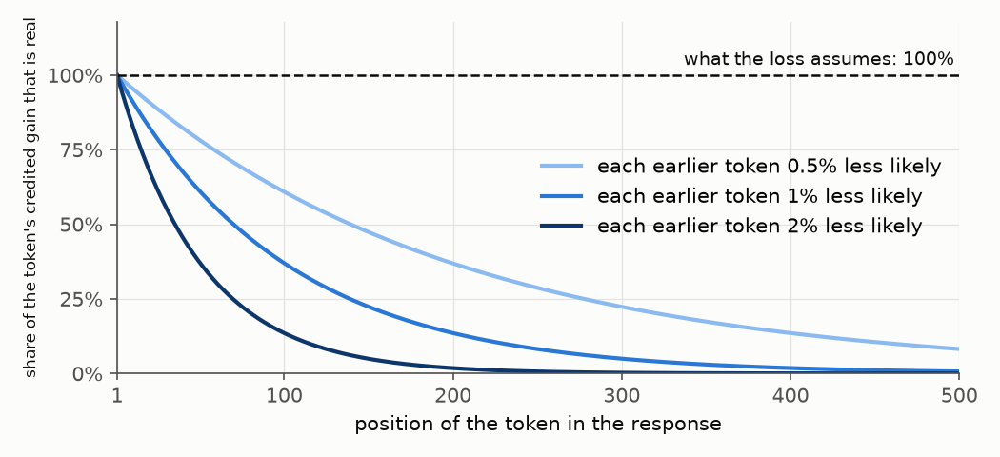

# Bias and variance of the policy gradient

## Summary

RL for language models estimates the policy gradient from a sampled batch, and the model being trained rarely
wrote that batch. The tokens come from an inference engine that is numerically different from the trainer
[[1]](#ref-1)[[2]](#ref-2), and the trainer takes several steps on one batch, so from the second step its
parameters are no longer the ones that wrote the tokens [[14]](#ref-14). Importance sampling (IS), truncated IS
(TIS), CISPO, PPO, GSPO and DPPO change the per-token weight to cope with that; GRPO and RLOO change the advantage.
This post measures how far each estimate lands from the true gradient.

- **Bias and variance are measured against the true gradient.** Bias is the offset of the estimate's average from
  it. Variance is the scatter around that average. A bigger batch shrinks only the variance (section 3).
- **A method that lowers one raises the other.** Ignoring the mismatch adds bias, bounded by the probability mass
  that moved. Correcting it with importance weights adds variance, which has no bound (5.1). The exception is a
  baseline, which lowers variance and adds no bias as long as the model wrote the tokens (section 4).
- **The best cap on the weight is set by the batch size.** On the toy it is 2.8 at a batch of 16 and 14.4 at 256,
  and at 16 the lowest error belongs to a biased estimator (5.2, 5.3).
- **The per-token loss ignores how a token depends on the tokens before it.** So it is only right near the model
  that wrote the batch, and a trust region keeps the model there. PPO and DPPO drop tokens that moved too far.
  PPO's ratio clip is a poor measure of the move, and DPPO measures the mass that moved (section 6).

Sections 2 to 5 use a toy with one position and three tokens, where the true gradient is exact. Section 6 adds a
second position. Every number can be checked by hand.

## 1. One sampled token gives one row

Let $z \in \mathbb{R}^V$ be the logits at one position and $p = \operatorname{softmax}(z)$ the trained model's
distribution. A sampled token $y$ with one-hot $e_y$, advantage $A$ and per-token weight $w$ contributes one
vector to the policy-gradient update on the logits [[3]](#ref-3):

$$x = w\,A\,(p - e_y).$$

Call it a row: a batch stacks one per sampled token. With $w = A = 1$ the row is the gradient of $-\log p_y$, the
cross-entropy loss on the written token. Training subtracts the row, which raises $p_y$ when $A > 0$.

## 2. The true gradient is the row averaged over the model's own tokens

The toy has one position and three tokens, and only token 2 is rewarded:

```python
p = [0.5, 0.3, 0.2]    # model
r = [0, 0, 1]          # reward if token y is written
```

Take $w = 1$ and $A = r_y$, and weight each token's row by how often the model writes that token:

| $y$ | $p_y$ | $A = r_y$ | $p - e_y$ | $p_y \cdot A \cdot (p - e_y)$ |
|---|---|---|---|---|
| 0 | 0.5 | 0 | (−0.5, 0.3, 0.2) | (0, 0, 0) |
| 1 | 0.3 | 0 | (0.5, −0.7, 0.2) | (0, 0, 0) |
| 2 | 0.2 | 1 | (0.5, 0.3, −0.8) | (0.10, 0.06, −0.16) |
| | | | **sum** | **$g$ = (0.10, 0.06, −0.16)** |

The sum is the true gradient,

$$g = \sum_y p_y\, r_y\,(p - e_y).$$

By the policy gradient identity it equals $-\nabla_z J$, the gradient of the average reward $J = \sum_y p_y\, r_y$
in loss sign [[3]](#ref-3)[[4]](#ref-4).

For a real model the sum runs over every possible response, $V^S$ of them for vocabulary $V$ and length $S$, so
every method below estimates $g$ from $B$ sampled responses instead. And $g$ is the gradient at the current
parameters: each optimizer step changes $p$, and with it $g$.

## 3. A bigger batch shrinks the variance and leaves the bias

Call the average of $B$ rows $\hat g_B$. With $w = 1$ and $A = r_y$ the rows for tokens 0 and 1 are zero, because
$A = 0$, and the row for token 2 is $p - e_2$. Call it $v$:

$$\begin{gathered}
v = p - e_2 = (0.5,\ 0.3,\ -0.8), \qquad g = 0.2\,v = (0.10,\ 0.06,\ -0.16), \\
\|v\|^2 = 0.25 + 0.09 + 0.64 = 0.98, \qquad \|g\|^2 = 0.2^2 \cdot 0.98 = 0.039.
\end{gathered}$$

Let $q$ be the probability that a sampled token is 2. A row is $v$ with probability $q$ and $0$ otherwise. Write
$c$ for the indicator of that draw, $c = 1$ if $y = 2$ and $c = 0$ if not:

$$x = c\,v, \qquad c \sim \text{Bernoulli}(q), \qquad
\hat g_B = \frac{k}{B}\,v, \qquad k = \textstyle\sum_{i=1}^{B} c_i \sim \text{Binomial}(B, q).$$

A batch average is $v$ times the fraction of 2s it drew, $k/B$.

The model writes token 2 at $q = p_2 = 0.2$. Now let an inference engine write the tokens, one that draws token 2
half as often, $q = 0.1$. Call it the close engine. Draw many batches of 16 from each:


*Figure 1: where batches of 16 land, 20,000 from each sampler. The axis is token 2's coordinate of the estimate,
$-0.8\,k/B$. Dashed is $g$'s, $-0.16$.*

The error of an estimator is its mean squared miss over batches, $\mathbb{E}\,\|\hat g_B - g\|^2$. It decomposes
into bias and variance [[5]](#ref-5):

$$\mathbb{E}\,\|\hat g_B - g\|^2 = \underbrace{\|\mathbb{E}[\hat g_B] - g\|^2}_{\text{bias}^2} + \underbrace{\mathbb{E}\,\|\hat g_B - \mathbb{E}[\hat g_B]\|^2}_{\text{variance}}.$$

The bias is a vector, the offset of the batches' center from $g$; the variance is their mean squared spread around
that center. The error is a squared distance, so the bias enters as its squared length and the two terms add.
Nothing here uses the toy's size: $x$ can be the full parameter gradient of a real model and the decomposition
reads the same.

:::note bias–variance decomposition
For any estimator $\hat\theta$ of a target $\theta$, with $m = \mathbb{E}[\hat\theta]$:

$$\hat\theta - \theta = (\hat\theta - m) + (m - \theta).$$

Square both sides, $\|a + b\|^2 = \|a\|^2 + 2\,a\cdot b + \|b\|^2$, and take expectations. The constant
$m - \theta$ comes out of the cross term, and what remains is zero:

$$\mathbb{E}\big[2\,(\hat\theta - m)\cdot(m - \theta)\big] = 2\,(m - \theta)\cdot\big(\mathbb{E}[\hat\theta] - m\big) = 0.$$

So

$$\mathbb{E}\,\|\hat\theta - \theta\|^2 = \underbrace{\mathbb{E}\,\|\hat\theta - m\|^2}_{\text{variance}} + \underbrace{\|m - \theta\|^2}_{\text{bias}^2}.$$

For a mean of $B$ independent samples the variance term is $\operatorname{Var}(\text{one sample})/B$. Here
$\hat\theta = \hat g_B$ and $\theta = g$ [[5]](#ref-5).
:::

Write $\operatorname{Var}(x) = \mathbb{E}\,\|x - \mathbb{E}[x]\|^2$, one number, for the spread of a single row. A
batch averages $B$ independent rows, so $\mathbb{E}[\hat g_B] = \mathbb{E}[x]$ and the variance term is
$\operatorname{Var}(x)/B$:

$$\mathbb{E}\,\|\hat g_B - g\|^2 = \|\mathbb{E}[x] - g\|^2 + \frac{\operatorname{Var}(x)}{B}.$$

For the toy's rows:

$$\mathbb{E}[x] = q\,v, \qquad \operatorname{Var}(x) = \|v\|^2\, q(1-q).$$

A Bernoulli($q$) has variance $q(1-q)$, and scaling it by the fixed vector $v$ scales the variance by
$\|v\|^2 = 0.98$.

| | model, $q = 0.2$ | engine, $q = 0.1$ |
|---|---|---|
| $\mathbb{E}[x] = q\,v$ | $0.2\,v$ = (0.10, 0.06, −0.16) | $0.1\,v$ = (0.05, 0.03, −0.08) |
| bias $= \mathbb{E}[x] - g$ | (0, 0, 0) | (−0.05, −0.03, +0.08) $= -0.1\,v$ |
| $\|\text{bias}\|^2$ | 0 | $0.05^2 + 0.03^2 + 0.08^2 = 0.0098$ |
| $\operatorname{Var}(x) = \|v\|^2\, q(1-q)$ | $0.98 \cdot 0.2 \cdot 0.8 = 0.157$ | $0.98 \cdot 0.1 \cdot 0.9 = 0.088$ |
| error $= \|\text{bias}\|^2 + \operatorname{Var}(x)/B$ | $0.157 / B$ | $0.0098 + 0.088 / B$ |

The model's bias is 0 because $q = p_2$: it writes token 2 at exactly the rate $g$ weights that row. At three
batch sizes:

| $B$ | model, $0.157/B$ | engine, $0.0098 + 0.088/B$ |
|---|---|---|
| 4 | 0.039 | 0.032 |
| 16 | 0.0098 | 0.0153 |
| 256 | 0.0006 | 0.0101 |

The engine draws token 2 one time in ten, so nine in ten of its rows are the zero vector. Rows that mostly agree
have little spread, hence the lower variance, but their average is $0.1\,v$, not $g$. The variance shrinks with
$B$; the bias does not. The errors are equal where $0.157/B = 0.0098 + 0.088/B$, at
$B = (0.157 - 0.088)/0.0098 = 7$: the engine wins below that and loses above it.

In the box below, the left panel draws $\|\text{bias}\|^2$, $\operatorname{Var}(x)/B$ and their sum against the
sampler's $q$, at the chosen $B$. The dashed lines mark the model, at $q = p_2$, and the engine. The right panel
draws each sampler's error against $B$, with the crossing marked. Moving $p_2$ changes $v$ too: the other two
tokens keep their 5 : 3 ratio.

:::widget samplers

## 4. A baseline lowers variance and adds no bias

A baseline subtracts the same $b$ from every reward. The average row stays at $g$, and the individual rows move
closer to it.

Replace $A = r_y$ with $A = r_y - b$ and multiply out the row:

$$(r_y - b)\,(p - e_y) = \underbrace{r_y\,(p - e_y)}_{\text{row without baseline}} \;-\; \underbrace{b\,(p - e_y)}_{\text{what the baseline subtracts}}.$$

Weighted by how often each token is written, the subtracted pieces sum to zero,
$\sum_y p_y\,(p - e_y) = p - p = 0$ [[3]](#ref-3)[[6]](#ref-6), so the average row is unchanged.

:::note a constant reward moves nothing, step by step
The toy's $p = (0.5, 0.3, 0.2)$ with a reward of $2$ whatever is drawn, so $A = 2$ for every row.

| | $y = 0$ | $y = 1$ | $y = 2$ |
|---|---|---|---|
| how often, $p_y$ | 0.5 | 0.3 | 0.2 |
| $e_y$ | (1, 0, 0) | (0, 1, 0) | (0, 0, 1) |
| $p - e_y$ | (−0.5, 0.3, 0.2) | (0.5, −0.7, 0.2) | (0.5, 0.3, −0.8) |
| row $= 2\,(p - e_y)$ | (−1.0, 0.6, 0.4) | (1.0, −1.4, 0.4) | (1.0, 0.6, −1.6) |
| $p_y \times$ row | (−0.50, 0.30, 0.20) | (0.30, −0.42, 0.12) | (0.20, 0.12, −0.32) |

Sum of the last line, coordinate by coordinate: $-0.50 + 0.30 + 0.20 = 0$, $0.30 - 0.42 + 0.12 = 0$,
$0.20 + 0.12 - 0.32 = 0$. Each row raises its own token and lowers the others (training subtracts the row). Token
0's row is drawn often and token 2's rarely, and in the weighted sum each token's raises cancel the lowerings it
gets from the other rows. A baseline is this table with $-b$ in place of $2$.
:::

The toy, $r = (0, 0, 1)$, without a baseline and with $b = 0.2$, the average reward:

| $y$ | $p_y$ | $p - e_y$ | $A = r_y$ | row $= A\,(p - e_y)$ | $A = r_y - 0.2$ | row $= A\,(p - e_y)$ |
|---|---|---|---|---|---|---|
| 0 | 0.5 | (−0.5, 0.3, 0.2) | 0 | (0, 0, 0) | −0.2 | (0.10, −0.06, −0.04) |
| 1 | 0.3 | (0.5, −0.7, 0.2) | 0 | (0, 0, 0) | −0.2 | (−0.10, 0.14, −0.04) |
| 2 | 0.2 | (0.5, 0.3, −0.8) | 1 | (0.50, 0.30, −0.80) | 0.8 | (0.40, 0.24, −0.64) |
| | | | | **avg (0.10, 0.06, −0.16) $= g$** | | **avg (0.10, 0.06, −0.16) $= g$** |
| | | | | **$\operatorname{Var}(x)$ 0.157** | | **$\operatorname{Var}(x)$ 0.103** |

Both averages are $g$. With the baseline the rows sit closer to it, so the variance,
$\sum_y p_y \|\text{row}_y\|^2 - \|g\|^2$, falls from $0.157$ to $0.103$.

The zero sum used $p_y$ as the rate at which token $y$ is written, which holds only when the model wrote the
tokens.

## 5. When another model wrote the tokens, the plain average is biased

Call whatever wrote the tokens $p_{\text{engine}}$, and $\rho_y = p_y / p_{\text{engine},y}$ the ratio of the
model's probability to it. There are two mismatches, and the arithmetic is the same for both:

| mismatch | why $p_{\text{engine}} \neq p$ | methods whose ratio is against it |
|---|---|---|
| engine vs trainer | different kernels, precision and batching [[1]](#ref-1) | IS, TIS, DPPO; REINFORCE ignores it |
| old vs new parameters, $p_{\text{engine}} = p_{\theta_{\text{old}}}$ | several optimizer steps on one batch; after the first, $\theta$ has moved [[14]](#ref-14) | PPO, CISPO, GSPO |

Two engines stand in for both, differing from the model only in how often they write the rewarded token:

```python
p     = [0.5,  0.3,  0.2 ]    # model: token 2 in 20 rows out of 100
close = [0.6,  0.3,  0.1 ]    # section 3's engine: 10 out of 100
far   = [0.69, 0.30, 0.01]    # a second engine: 1 out of 100
```

### 5.1 Raising the weight trades bias for variance

The far engine writes token 2 once in 100 rows where the model writes it 20 times. So the rewarded row, $v$, shows
up twenty times too rarely. Tokens 0 and 1 have $A = 0$, so only token 2's weight, $w_2$, matters: how much the
rewarded row counts when it does show up.

- REINFORCE counts it once and ignores the shortfall.
- IS [[10]](#ref-10)[[12]](#ref-12) counts it 20 times, the full shortfall.
- TIS [[13]](#ref-13)[[1]](#ref-1) would count it 20 times too, but stops at a cap, here 2.

Eight batches of 16 from the far engine, one of which drew the row:

| batch | token-2 rows | REINFORCE, $w_2 = 1$ | TIS, $w_2 = 2$ | IS, $w_2 = 20$ |
|---|---|---|---|---|
| 1 | 0 | 0 | 0 | 0 |
| 2 | 0 | 0 | 0 | 0 |
| 3 | 1 | $\tfrac{1}{16}\,v = 0.31\,g$ | $\tfrac{2}{16}\,v = 0.63\,g$ | $\tfrac{20}{16}\,v = 6.25\,g$ |
| 4 | 0 | 0 | 0 | 0 |
| 5 | 0 | 0 | 0 | 0 |
| 6 | 0 | 0 | 0 | 0 |
| 7 | 0 | 0 | 0 | 0 |
| 8 | 0 | 0 | 0 | 0 |
| average over many batches | 0.16 of 16 | $0.01\,v = 0.05\,g$ | $0.02\,v = 0.10\,g$ | $0.2\,v = g$ |

REINFORCE delivers a third of the truth in the one batch and nothing in the other seven, and its average settles
at a twentieth of $g$. IS multiplies the row by 20, which is exactly how under-counted it is, so the average lands
on $g$; but seven batches say zero and one says $6.25\,g$. TIS counts the row twice: a tenth of the truth on
average, with a tenth of IS's swing.

The bias has a ceiling and the variance has none. The far engine's mismatch, token by token:

| token $y$ | $p_y$ | $p_{\text{engine},y}$ | difference $p_y - p_{\text{engine},y}$ | ratio $\rho_y = p_y / p_{\text{engine},y}$ |
|---|---|---|---|---|
| 0 | 0.50 | 0.69 | −0.19 | 0.72 |
| 1 | 0.30 | 0.30 | 0 | 1.0 |
| 2 | 0.20 | 0.01 | +0.19 | 20 |

**Ignore the mismatch and the estimate is short.** REINFORCE's average row is $0.01\,v$ where $g = 0.2\,v$:

$$\text{bias} = (p_{\text{engine},2} - p_2)\, v = -0.19\, v.$$

The 0.19 is the mass that moved off token 2. Total variation is the name for moved mass [[9]](#ref-9), half the
sum of the difference column because each move is counted where it leaves and where it lands:

$$\mathrm{TV} = \tfrac{1}{2}\textstyle\sum_y |p_y - p_{\text{engine},y}| = \tfrac12 (0.19 + 0 + 0.19) = 0.19.$$

It never exceeds 1, and it bounds the bias. REINFORCE's bias is
$\sum_y (p_{\text{engine},y} - p_y)\, r_y\,(p - e_y)$, the difference column with each entry multiplied by that
token's row, so it is at most $2\,\mathrm{TV}$ times the longest row. In the toy only token 2's row is nonzero and
the bias is exactly $-0.19\,v$.

**Correct the mismatch and the estimate is jumpy.** IS's row is $20\,v$ once in a hundred and $0$ otherwise:

$$\operatorname{Var}(x) = \mathbb{E}\|x\|^2 - \|g\|^2 = 0.01 \cdot 20^2 \cdot 0.98 - 0.039 = 4.0 \cdot 0.98 - 0.039 = 3.88.$$

The 4.0 is $p_{\text{engine},2}\,\rho_2^2 = 0.01 \cdot 400$: how often the weight fires times its square.
Chi-squared is the name for that quantity summed over tokens [[11]](#ref-11), the variance of $\rho$ when the
engine draws:

$$\begin{aligned}
\chi^2(p \,\|\, p_{\text{engine}}) &= \textstyle\sum_y p_{\text{engine},y}\, \rho_y^2 - 1 \\
&= 0.69 \cdot 0.72^2 + 0.30 \cdot 1^2 + 0.01 \cdot 20^2 - 1 = 0.36 + 0.30 + 4.0 - 1 = 3.66.
\end{aligned}$$

It has no ceiling. At $p_{\text{engine},2} = 0.001$ the weight is 200 and the term is $0.001 \cdot 200^2 = 40$,
while TV has only moved to 0.199.

### 5.2 Unbiased loses at $B = 16$ and wins at $B = 256$

Three more weights are functions of $\rho$ and differ in what they do when $\rho$ leaves a band around 1.

- **PPO** [[14]](#ref-14), ratio against $\theta_{\text{old}}$, uses $w = \rho_y$ and sets $w = 0$ once $\rho_y$
  has left $[1 - \epsilon, 1 + \epsilon]$ on the side $A$ pushes toward: $\rho_y > 1 + \epsilon$ with $A > 0$, or
  $\rho_y < 1 - \epsilon$ with $A < 0$. $\epsilon = 0.2$, the paper's default. Token 2 has $A > 0$ and
  $\rho_2 = 2$ on the close engine, 20 on the far one, so $w_2 = 0$ on both.
- **CISPO** [[21]](#ref-21), ratio against $\theta_{\text{old}}$, clamps $\rho_y$ at a cap and stops the gradient
  through the clamp, so a token above the cap gets $w = \text{cap}$ where PPO gives $w = 0$. On the toy it is TIS
  with a higher cap. The paper tunes the cap without publishing it, so this post uses 4.
- **DPPO** [[2]](#ref-2), ratio against the engine, uses $w = \rho_y$ and sets $w = 0$ once the moved mass
  $|p_y - p_{\text{engine},y}|$ passes $\delta = 0.15$ in the direction $A$ pushes: up with $A > 0$, down with
  $A < 0$. Token 2 moved 0.19 on the far
  engine, so DPPO drops it there, and 0.10 on the close one, so it keeps $w_2 = \rho_2 = 2$.

With $q$ the engine's rate for token 2, a weight $w_2$ on the rewarded row gives

$$\text{bias} = (q\,w_2 - p_2)\,v, \qquad \operatorname{Var}(x) = w_2^2\,\|v\|^2\,q(1-q).$$

Table 1: every method on both engines, $b = 0$, $\operatorname{Var}(x)$ of one row. Every bias is a multiple of
$v$, so one coefficient gives it.

| engine | method | $w_2$ | bias | $\|\text{bias}\|^2$ | $\operatorname{Var}(x)$ | <span class="c-shade">error, $B = 16$</span> | <span class="c-shade">error, $B = 256$</span> |
|---|---|---|---|---|---|---|---|
| close | REINFORCE | 1 | $-0.10\,v$ | 0.0098 | 0.088 | 0.015 | 0.010 |
| close | IS, TIS, CISPO, DPPO | 2 | 0 | 0 | 0.353 | 0.022 | 0.0014 |
| close | PPO | 0 | $-0.20\,v$ | 0.0392 | 0 | 0.039 | 0.039 |
| far | REINFORCE | 1 | $-0.19\,v$ | 0.0354 | 0.010 | 0.036 | 0.035 |
| far | IS | 20 | 0 | 0 | 3.881 | 0.243 | 0.015 |
| far | TIS (cap 2) | 2 | $-0.18\,v$ | 0.0318 | 0.039 | 0.034 | 0.032 |
| far | CISPO (cap 4) | 4 | $-0.16\,v$ | 0.0251 | 0.155 | 0.035 | 0.026 |
| far | PPO, DPPO | 0 | $-0.20\,v$ | 0.0392 | 0 | 0.039 | 0.039 |

1. **Unbiased is not better at $B = 16$.** On the close engine REINFORCE beats IS; on the far one TIS beats both.
   At $B = 256$ IS wins on both.
2. **PPO and DPPO are not trying to estimate this step's gradient well.** They stop the step on a token that already
   moved too far, and section 6 shows why. A dropped row is the zero vector every time: no scatter, so no
   variance, and a bias of $-0.20\,v = -g$, which is why they have the largest error in the table.

### 5.3 The best cap grows with the batch

A cap between 1 and $\rho$ turns part of the variance into bias. Only the variance is divided by $B$, so the best
cap rises with $B$. Put $w_2 = \text{cap}$ in Table 1's
error, $\|\text{bias}\|^2 + \operatorname{Var}(x)/B$, and set the derivative in the cap to zero:

$$\begin{aligned}
\text{error} &= \|v\|^2 \Big[ (q\,\text{cap} - p_2)^2 + \frac{\text{cap}^2\, q(1-q)}{B} \Big], \\
0 &= 2q\,(q\,\text{cap} - p_2) + \frac{2\,\text{cap}\; q(1-q)}{B}, \\
p_2 &= \text{cap}\,\Big( q + \frac{1-q}{B} \Big), \\
\text{best cap} &= \frac{p_2}{q + (1-q)/B}.
\end{aligned}$$

As $B$ grows, the best cap goes to $p_2 / q = \rho_2$, which is IS. Far engine:

| $B$ | best cap | error at the best cap | cap 2 | cap 4 | no cap |
|---|---|---|---|---|---|
| 16 | 2.8 | 0.034 | 0.034 | 0.035 | 0.243 |
| 256 | 14.4 | 0.011 | 0.032 | 0.026 | 0.015 |

Common TIS implementations cap at 2 [[1]](#ref-1), close to the best at $B = 16$ and well below it at $B = 256$.
V-trace [[15]](#ref-15) and Retrace [[16]](#ref-16) cap the same ratio at 1 in classic off-policy RL.

## 6. The loss is only right near the model that wrote the batch

The surrogate is the current model's reward, estimated from responses the old model wrote. The real reward would
need fresh responses from the current model. The estimate re-counts the old ones instead: each token's ratio says
how much more or less often the current model writes it. Training climbs this estimate, so it is the loss
[[14]](#ref-14), and the row with $w = \rho$ is its gradient. Before the first step every ratio is 1 and the
estimate is exact. It drifts as the model moves away. A trust region is the range of moves small enough that it
stays accurate. Two papers carry the section: TRPO [[18]](#ref-18) for why to stay close, and DPPO [[2]](#ref-2)
for how to measure close.

### 6.1 A token's ratio does not see the tokens before it

This needs two positions. A response is two tokens, each $a$ or $b$, and the reward is 1 if the second token is
$b$. One optimizer step moves the model:

| | old model | current model |
|---|---|---|
| first token is $a$ | 50% | 40% |
| second is $b$, after $a$ | 10% | 20% |
| second is $b$, after $b$ | 50% | 50% |

Take the rewarded response "$a\,b$". Out of 100 responses the old model wrote it 5 times: 50 start with $a$, and
10% of those end in $b$. The current model writes it 8 times: 40 start with $a$, and 20% of those end in $b$.

The loss has only the old batch's 5, and re-counts them with one ratio per token:

| token | old → current | ratio $\rho$ | re-count of the 5 |
|---|---|---|---|
| first, $a$ | 50% → 40% | 0.8 | 5 × 0.8 = 4, one fewer |
| second, $b$ after $a$ | 10% → 20% | 2.0 | 5 × 2.0 = 10, five more |

The loss is a sum over tokens, so it adds the two changes. The true count multiplies the two ratios:

$$\text{loss: } 5 - 1 + 5 = 9, \qquad \text{current model: } 5 \times 0.8 \times 2.0 = 8.$$

This is dependence along the path. The second token's five extra responses were counted on all five in the batch,
as if a response starting with $a$ were as common now as when the batch was written. The batch starts with $a$
50% of the time and the current model 40%, so only 40/50 = 80% of the five are real: 5 − 1 + 4 = 8.

Each further token multiplies in one more ratio, so the miss grows with the length of the response:



*Figure 2: the share of a token's credited gain that is real, by its position in the response, when a step makes
every earlier token 0.5%, 1% or 2% less likely. At 1% it is 37% at token 100 and under 1% at token 500.*

Multiplying the ratios is exact, but over 500 tokens the product has a variance too large for any batch, so every
method in section 5 uses one ratio per token.

### 6.2 The error grows with the square of the move

Repeat the example with a smaller or a bigger move: the first token's $a$ goes down by the same number of points
that $b$ after $a$ goes up. 10 points is the example above, where the old batch's 5 became 9 in the loss and 8 in
truth.

On a real model the truth is unknown without sampling again, and so is the gap. TRPO
[[17]](#ref-17)[[18]](#ref-18)[[19]](#ref-19) proves a ceiling on the gap that needs no new samples, and DPPO
states it for a response of $T$ tokens (Theorem 3.2 in [[2]](#ref-2)):

$$\text{gap} = \text{loss says} - \text{truth} \;\le\; 2\,\xi\,T(T-1)\,\mathrm{TV}_{\max}^2,$$

where $\xi$ is the largest reward and $\mathrm{TV}_{\max}$ the most probability mass that moved at any token. On
the toy $\xi = 1$, $T = 2$ and $\mathrm{TV}_{\max}$ is the move. The table counts per 100 responses, so the
ceiling is multiplied by 100.

Table 2: the count of "$a\,b$" in the loss and in truth, the gap, and the theorem's ceiling on it. The old batch
holds 5.

| move | loss says | truth | gap | ceiling on the gap, $2\,\xi\,T(T-1)\,\mathrm{TV}_{\max}^2 \times 100$ |
|---|---|---|---|---|
| 1 point | 5.40 | 5.39 | 0.01 | $2 \cdot 1 \cdot 2 \cdot 1 \cdot 0.01^2 \times 100 = 0.04$ |
| 10 points | 9 | 8 | 1 | $2 \cdot 1 \cdot 2 \cdot 1 \cdot 0.10^2 \times 100 = 4$ |
| 20 points | 13 | 9 | 4 | $2 \cdot 1 \cdot 2 \cdot 1 \cdot 0.20^2 \times 100 = 16$ |
| 30 points | 17 | 8 | 9 | $2 \cdot 1 \cdot 2 \cdot 1 \cdot 0.30^2 \times 100 = 36$ |

1. **The gap grows with the square of the move.** Double the move and the gap quadruples: 1, 4, 9.
2. **The loss keeps climbing while the truth turns back.** From 20 to 30 points the loss goes from 13 to 17 and
   the real count falls from 9 to 8.
3. **The ceiling is always above the gap, and it also grows with the square.** A small move keeps it small, so
   what the loss says can be trusted. The range of moves where it can is the trust region. If the loss's gain on
   the whole batch is larger than the ceiling, the real reward went up for certain, which is TRPO's monotonic
   improvement.

The ceiling is loose, four times the gap here, and $T(T-1)$ loosens it further for long responses. In practice
the size of the region is a tuned number.

TRPO's ceiling is on a bias: it is computed from exact quantities and does not shrink with the batch. There is
also a trust region for the variance term. Metelli et al. [[24]](#ref-24) bound how far an importance-weighted
estimate can fall below the real value by a term in $\sqrt{(1 + \chi^2)/B}$, the divergence of 5.1 over the
batch size, and optimize that lower bound on each batch. TRPO's region limits the bias term of section 3's error,
and this one limits the variance term.

### 6.3 PPO measures the move by one token's ratio, DPPO by the mass that moved

The zeros in Table 1 enforce the trust region. Once a token has moved too far from the model that wrote the
batch, its row gets $w = 0$: a bias of $-g$ on that token, taken so that the loss is not followed past where it is
right. On a fresh batch every PPO ratio is 1 and nothing is dropped, so its zeros appear from the second step on
a batch. DPPO, whose ratio is against the engine, can also drop a token on the first step.

The bound is in moved probability mass, and PPO does not measure that. It checks the ratio of the one token that
was sampled. DPPO's argument is that one token's ratio is a poor reading of how far the distribution moved
(section 4.2 in [[2]](#ref-2)), and it measures the moved mass, $|p - p_{\text{engine}}|$, directly:

Table 3: PPO and DPPO on a rare token with $A > 0$ and a confident token with $A < 0$.

| token | $p_{\text{engine}} \to p$ | $\rho$ | moved | PPO ($\epsilon = 0.2$) | DPPO ($\delta = 0.15$) |
|---|---|---|---|---|---|
| rare | 0.0001 → 0.01 | 100 | 0.0099 | $w = 0$ | $w = 100$ |
| confident | 0.99 → 0.80 | 0.81 | 0.19 | $w = 0.81$ | $w = 0$ |

PPO blocks the token that barely moved and passes the one that carries most of the move. In the paper's
experiments the methods with no trust region, IS and CISPO, collapse even at the small learning rates of LLM
fine-tuning, and masking only the negative-advantage tokens whose probability fell by more than 0.5, at most 0.5%
of updates, is enough to keep training stable (section 5 and Figure 5 in [[2]](#ref-2)).

## 7. Each algorithm is one advantage and one weight

Every method chooses the two factors of the row $x = w\,A\,(p - e_y)$.

### 7.1 Baselines cut variance; std and length division add bias

**Group-mean baseline** (GRPO [[7]](#ref-7)): $A = r_y - b$ with $b$ the mean reward of the $G$ responses to the
same prompt. A shift, so the subtracted piece averages to zero (section 4) and only the variance falls. The mean
includes the response's own reward, which scales the average row by $(G - 1)/G$. A constant scale on $g$ keeps its
direction; the learning rate absorbs it. RLOO [[20]](#ref-20) averages the other $G - 1$ responses and removes the
scale.

**Std and length division** (GRPO [[7]](#ref-7)): $A = (r_y - b)/\operatorname{std}$, and the token sum divided by
response length. These factors differ from prompt to prompt and response to response, so they reweight $g$ rather
than scale it. Dr. GRPO [[8]](#ref-8) names both effects, the std division weighting up prompts whose rewards are
nearly all right or all wrong and the length division penalizing a long wrong response less per token than a short
one, and removes both factors. The toy has one prompt and one position, so neither factor varies and neither
effect appears.

### 7.2 The weights differ in where they cap or zero the ratio

REINFORCE ignores the ratio, IS uses it whole, TIS and CISPO cap it, and PPO and DPPO zero it past a threshold
(section 5, 6.3). Two more methods move where the zero falls:

- **DAPO's clip-higher** [[23]](#ref-23) widens the upper edge of PPO's band, so fewer rare tokens with positive
  $A$ are zeroed: less bias, more variance.
- **GSPO** [[22]](#ref-22) uses one ratio per response, the geometric mean of the per-token ratios, and zeroes
  every token of the response when that ratio leaves a tight band. Averaging log-ratios cuts the ratio's variance;
  whole-response zeros add bias. On the one-position toy the sequence ratio is $\rho_2$ and GSPO coincides with
  PPO.

Table 4: each choice, the term it lowers and the term it raises.

| choice | $A$ | $w$ | lowers | raises |
|---|---|---|---|---|
| no baseline | $r_y$ | | nothing: the reference point | nothing |
| group mean (GRPO) | $r_y - b$ | | variance | a scale of $g$ by $(G-1)/G$, direction unchanged |
| leave-one-out mean (RLOO) | $r_y - b$, own reward excluded | | variance | nothing |
| std, length division (GRPO) | $(r_y - b)/\operatorname{std}$, $/\text{length}$ | | the spread of $A$ across prompts | bias: $g$ reweighted by group spread and length |
| REINFORCE | | $1$ | variance | bias, with TV |
| IS | | $\rho$ | bias, to zero | variance, with $\chi^2$ |
| TIS | | $\min(\rho, 2)$ | variance above the cap | bias where the cap binds |
| CISPO | | $\min(\rho, 4)$, stop-gradient on the ratio | bias, relative to TIS; no zeroed rows | variance, relative to TIS |
| PPO | | $\rho$; $0$ past the band on the side $A$ pushes toward | variance on zeroed tokens; the loss's gap (6.2) | bias $-g$ on zeroed tokens |
| GSPO | | sequence ratio; $0$ outside a tight band, per response | variance from per-token ratios | bias: whole responses zeroed |
| DPPO | | $\rho$; $0$ when moved mass $> \delta$ on the side $A$ pushes toward | the loss's gap (6.2); fewer zeros on rare tokens than PPO | bias $-g$ on zeroed tokens; IS's variance on rare tokens that pass |

## References

1. <a id="ref-1"></a>F. Yao, L. Liu, D. Zhang, C. Dong, J. Shang, J. Gao. *Your Efficient RL Framework Secretly Brings You Off-Policy RL Training.* Blog, 2025. https://fengyao.notion.site/off-policy-rl
2. <a id="ref-2"></a>P. Qi, X. Zhou, Z. Liu, T. Pang, C. Du, M. Lin, W. S. Lee. *Rethinking the Trust Region in LLM Reinforcement Learning* (DPPO). arXiv:2602.04879, 2026.
3. <a id="ref-3"></a>R. J. Williams. *Simple Statistical Gradient-Following Algorithms for Connectionist Reinforcement Learning* (REINFORCE). Machine Learning 8:229-256, 1992.
4. <a id="ref-4"></a>R. S. Sutton, D. McAllester, S. Singh, Y. Mansour. *Policy Gradient Methods for Reinforcement Learning with Function Approximation.* NeurIPS, 2000.
5. <a id="ref-5"></a>L. Wasserman. *All of Statistics.* Springer, 2004 (bias-variance decomposition of mean squared error).
6. <a id="ref-6"></a>E. Greensmith, P. L. Bartlett, J. Baxter. *Variance Reduction Techniques for Gradient Estimates in Reinforcement Learning.* JMLR 5:1471-1530, 2004.
7. <a id="ref-7"></a>Z. Shao et al. *DeepSeekMath* (GRPO). arXiv:2402.03300, 2024.
8. <a id="ref-8"></a>Z. Liu et al. *Understanding R1-Zero-Like Training: A Critical Perspective* (Dr. GRPO). arXiv:2503.20783, 2025.
9. <a id="ref-9"></a>D. A. Levin, Y. Peres, E. L. Wilmer. *Markov Chains and Mixing Times.* AMS, 2009 (total variation distance, chapter 4).
10. <a id="ref-10"></a>A. B. Owen. *Monte Carlo Theory, Methods and Examples*, chapter 9: Importance Sampling. 2013. https://artowen.su.domains/mc/
11. <a id="ref-11"></a>S. Agapiou, O. Papaspiliopoulos, D. Sanz-Alonso, A. M. Stuart. *Importance Sampling: Intrinsic Dimension and Computational Cost.* Statistical Science, 2017; arXiv:1511.06196 (eq. 2.4: second moment of the weight minus 1 is the chi-squared divergence).
12. <a id="ref-12"></a>T. Degris, M. White, R. S. Sutton. *Off-Policy Actor-Critic.* ICML, 2012; arXiv:1205.4839.
13. <a id="ref-13"></a>E. L. Ionides. *Truncated Importance Sampling.* Journal of Computational and Graphical Statistics 17(2):295-311, 2008.
14. <a id="ref-14"></a>J. Schulman, F. Wolski, P. Dhariwal, A. Radford, O. Klimov. *Proximal Policy Optimization Algorithms.* arXiv:1707.06347, 2017.
15. <a id="ref-15"></a>L. Espeholt et al. *IMPALA* (V-trace). arXiv:1802.01561, 2018.
16. <a id="ref-16"></a>R. Munos, T. Stepleton, A. Harutyunyan, M. G. Bellemare. *Safe and Efficient Off-Policy Reinforcement Learning* (Retrace). arXiv:1606.02647, 2016.
17. <a id="ref-17"></a>S. Kakade, J. Langford. *Approximately Optimal Approximate Reinforcement Learning.* ICML, 2002.
18. <a id="ref-18"></a>J. Schulman, S. Levine, P. Moritz, M. Jordan, P. Abbeel. *Trust Region Policy Optimization.* arXiv:1502.05477, 2015.
19. <a id="ref-19"></a>J. Achiam, D. Held, A. Tamar, P. Abbeel. *Constrained Policy Optimization.* arXiv:1705.10528, 2017.
20. <a id="ref-20"></a>A. Ahmadian, C. Cremer, M. Gallé, M. Fadaee, J. Kreutzer, O. Pietquin, A. Üstün, S. Hooker. *Back to Basics: Revisiting REINFORCE Style Optimization for Learning from Human Feedback in LLMs* (RLOO). arXiv:2402.14740, 2024.
21. <a id="ref-21"></a>MiniMax (A. Chen et al.). *MiniMax-M1: Scaling Test-Time Compute Efficiently with Lightning Attention* (CISPO). arXiv:2506.13585, 2025.
22. <a id="ref-22"></a>C. Zheng, S. Liu, M. Li, X.-H. Chen, B. Yu, C. Gao, K. Dang, Y. Liu, R. Men, A. Yang, J. Zhou, J. Lin. *Group Sequence Policy Optimization* (GSPO). arXiv:2507.18071, 2025.
23. <a id="ref-23"></a>Q. Yu et al. *DAPO: An Open-Source LLM Reinforcement Learning System at Scale.* arXiv:2503.14476, 2025.
24. <a id="ref-24"></a>A. M. Metelli, M. Papini, F. Faccio, M. Restelli. *Policy Optimization via Importance Sampling.* NeurIPS, 2018; arXiv:1809.06098.
