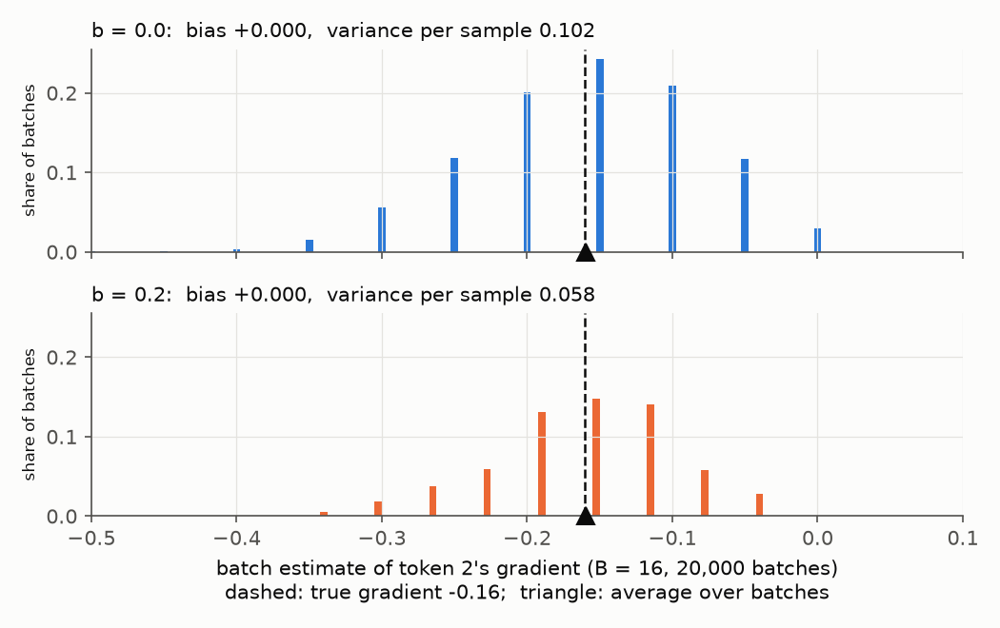
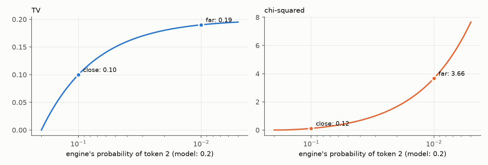
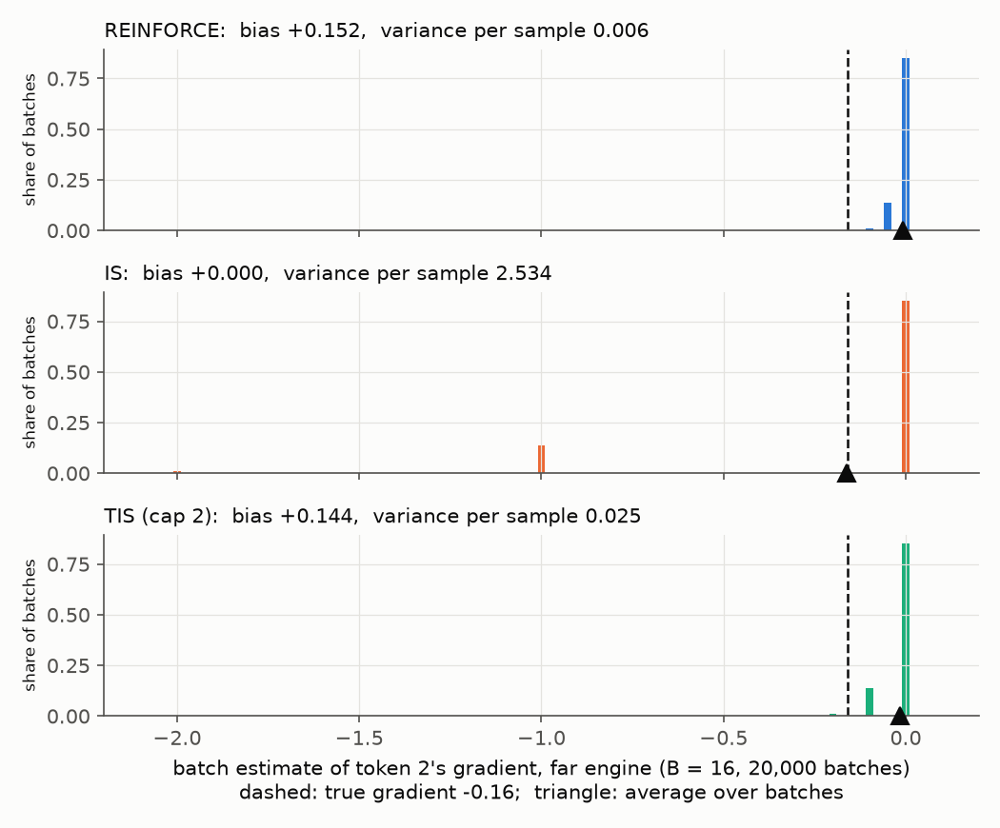
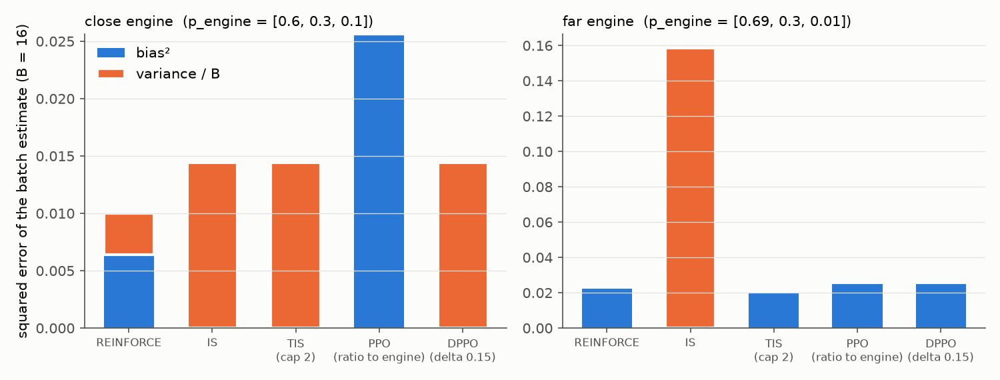
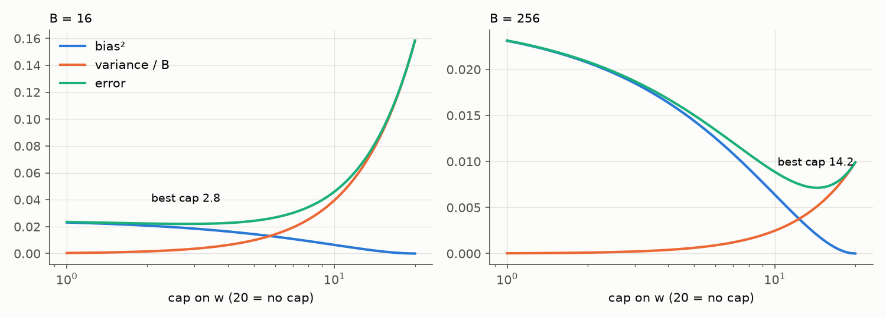

# Bias and variance of the policy gradient

## 1. The question

Training follows `dlogits = w * A * (p - y_onehot) / (B * S)`, computed from one batch. How far is that from the
gradient we actually want, and what does each correction (`w` in pglab's methods) do to the gap?

## 2. The true gradient

The goal is the model's average reward. In a toy with one position and three tokens:

```python
p    = [0.5, 0.3, 0.2]    # [V]  how often the model writes each token
R_of = [0.0, 0.0, 1.0]    # [V]  reward if token k is written: only token 2 is right
J = 0.5*0 + 0.3*0 + 0.2*1 = 0.2    # average reward over everything the model could write
```

The true gradient is how `J` changes when the logits change. `J` is a sum over every response the model could write,
so its gradient is too: each response contributes how often it is written, times its reward, times the direction
that makes it likelier. Here that sum is `[0.10, 0.06, -0.16]` in `dlogits` form (autograd agrees). Training
subtracts `dlogits`, so token 2's `-0.16` pushes it up.

With three responses we can add them all up. A real model has `V**S` possible responses (`10**4` in pglab, far more
than atoms in the universe for an LLM), so we sample a batch of `B` and average instead. The rest of this post
follows one number, token 2's entry `-0.16`, and asks how the batch's version of it behaves.

## 3. One sample, one guess

One position, so `S = 1`:

```python
y        = sampled tokens            # [B]
A        = R_of[y] - b               # [B]  advantage: reward minus a baseline b
dlogits  = w * A * (p - y_onehot) / B     # [B, V]
estimate = dlogits.sum(0)[2]         # ()   the batch's version of token 2's gradient
```

With `w = 1` and `b = 0`, each sample adds one of two values to token 2's entry:

```python
y = 2:  A = 1  ->  1 * (0.2 - 1) = -0.8    # written 20% of the time
y = 0 or 1: A = 0  ->  0                   # written 80% of the time
average = 0.2 * -0.8 = -0.16               # the true gradient
```

Two numbers describe the estimate:

- **Bias**: its average over many batches, minus the true value. Bias does not shrink with more samples.
- **Variance**: how far one sample lands from the average, squared and averaged. A batch of `B` divides it by `B`.

```python
error = bias**2 + variance / B
```

## 4. Baseline: less variance, no bias

Subtract `b = 0.2`, the average reward. The sampled rows change, the average does not: over the model's own samples,
`p - y_onehot` averages to 0, so subtracting `b` times it subtracts 0.



*Figure 1: 20,000 batches of 16, model sampling itself. Both baselines center on the true value (no bias). With
`b = 0.2` the spread shrinks from 0.102 to 0.058 per sample.*

GRPO uses the group's mean reward as `b`. (Its other two steps, dividing by the group's reward std and by response
length, do add bias; see [Dr. GRPO](https://arxiv.org/abs/2503.20783).)

## 5. When the engine writes the tokens

Now `y` comes from the engine, so tokens show up at the engine's rates, not the model's. We still want the model's
`-0.16`. Two engines, `b = 0`:

```python
p     = [0.5,  0.3,  0.2 ]    # [V]  model
close = [0.6,  0.3,  0.1 ]    # [V]  engine writes token 2 half as often as the model
far   = [0.69, 0.30, 0.01]    # [V]  engine almost never writes token 2
```

### 5.1 Two distances between engine and model

**Total variation (TV): how much probability moved.**

```python
p - close = [-0.1, 0.0, +0.1]    # take 0.1 from token 0, give it to token 2
```

`sum(|p - close|)` is 0.2, but it counts every move twice, once where it leaves and once where it lands. So the
amount moved is `TV = 0.5 * sum(|p - p_engine|)`: 0.10 for close, 0.19 for far.

**Chi-squared: how big the weights get.** The weight that undoes the mismatch is `w = p / p_engine`:

```python
w_close = [0.83, 1.0,  2.0]    # [V]
w_far   = [0.72, 1.0, 20.0]    # [V]
```

Under the engine the weight always averages to 1: each term `p_engine[k] * (p[k] / p_engine[k])` is just `p[k]`. So
the weight's variance is its average square minus 1:

```python
close: 0.6*0.83**2  + 0.3*1**2 + 0.1*2**2   - 1 = 0.12
far:   0.69*0.72**2 + 0.3*1**2 + 0.01*20**2 - 1 = 3.66
```

That is the chi-squared distance. Each token adds `p**2 / p_engine`, so a token the engine rarely writes blows it up.



*Figure 2: engine `[0.7 - e, 0.3, e]` as `e`, the engine's probability of token 2, falls from 0.2 (same as the
model) to 0.005. TV levels off at 0.2. Chi-squared explodes.*

### 5.2 Three weights

Each sample now adds `-0.8 * w[2]` if it wrote token 2, and 0 otherwise.

- **REINFORCE**, `w = 1`: token 2 shows up at the engine's rate, so the average is `-0.8 * 0.01 = -0.008` with the
  far engine. Bias `+0.152`: it barely pushes token 2.
- **IS**, `w = p / p_engine = 20` on token 2: the average is `-0.8 * 20 * 0.01 = -0.16`, exact. But 85% of batches
  of 16 never see token 2 and estimate 0; the 14% that see it once estimate `-1.0`.
- **TIS**, `w` capped at 2: in between, mostly bias.



*Figure 3: the far engine, 20,000 batches of 16. REINFORCE and TIS are tight but centered in the wrong place (bias).
IS is centered on the truth on average, but no single batch lands near it (variance).*

### 5.3 Every method, both engines

pglab's methods each choose `w`. Here are their errors at `B = 16`, split into bias² and variance:



*Figure 4: squared error of the batch estimate at `B = 16`. Close engine (left): IS, TIS and DPPO coincide (the cap
of 2 does not bind, and DPPO passes since only 0.10 moved). Far engine (right): IS is mostly variance, the rest are
mostly bias.*

Table 1: the numbers behind Figure 4 (`b = 0`, per-sample variance, error at `B = 16`).

| engine | method | `w` on token 2 | bias | variance | error |
|---|---|---|---|---|---|
| close | REINFORCE | 1 | +0.080 | 0.058 | 0.010 |
| close | IS, TIS, DPPO | 2 | 0 | 0.230 | 0.014 |
| close | PPO (ratio to engine) | 0 | +0.160 | 0 | 0.026 |
| far | REINFORCE | 1 | +0.152 | 0.006 | 0.024 |
| far | IS | 20 | 0 | 2.534 | 0.158 |
| far | TIS | 2 | +0.144 | 0.025 | 0.022 |
| far | PPO, DPPO | 0 | +0.160 | 0 | 0.026 |

Three things to take from this:

1. **Unbiased is not the same as better.** With the close engine, plain REINFORCE beats IS at `B = 16`.
2. **The trust-region methods look worst here, by design.** PPO (with its ratio taken against the engine, as in
   miles `--use-rollout-logprobs`) and DPPO set `w = 0` on token 2, so they estimate 0. They are not trying to
   estimate one gradient well. They stop the step on tokens that already moved too far. That benefit only shows up
   across steps (section 6).
3. **PPO and DPPO disagree with the close engine.** Token 2's ratio is 2, so PPO blocks it. Only 0.10 of
   probability moved, under DPPO's 0.15, so DPPO keeps it.

### 5.4 Where to put the cap

A cap trades variance for bias. Where the best trade sits depends on the batch size:



*Figure 5: far engine, error versus the cap on `w`. At `B = 16` the best cap is about 3. At `B = 256` the variance is
16 times smaller, so the best cap rises to about 14.*

pglab's `tis` and miles `--use-tis` cap at 2. The same trade appears in classic RL as
[V-trace](https://arxiv.org/abs/1802.01561) and [Retrace](https://arxiv.org/abs/1606.02647).

## 6. Across steps: the blind spot and the trust region

So far, one estimate. Training takes steps, and a step can hide a second kind of bias.

`w` fixes which token is written at a prefix. It cannot fix how often each prefix is reached. Two tokens; reward 1 if
the second token is `b`. The engine writes the first token 50/50, and after `a` it writes `b` 10% of the time. A step
moves the first token toward `a` by `d`, and "after `a`" toward `b` by `d`.

Table 2: the gain the weighted batch predicts (surrogate) vs the true gain in average reward.

| `d` | true gain | surrogate | gap |
|---|---|---|---|
| 0.01 | 0.0011 | 0.0010 | 0.0001 |
| 0.1 | 0.0200 | 0.0100 | 0.0100 |
| 0.3 | 0.1200 | 0.0300 | 0.0900 |

The stepped model reaches "after `a`" more often, and it also improved there. The batch was written by the engine and
never saw that. The DPPO paper ([arXiv 2602.04879](https://arxiv.org/abs/2602.04879), Theorem 3.2) proves the gap is
at most a constant times the TV summed over the response. So keep TV small at every token. That is a trust region,
and it is what the zeros in Figure 4 pay for.

PPO measures movement with the ratio, `|r - 1|`. DPPO measures `|p - p_engine|`, which equals `p_engine * |r - 1|`,
the token's actual share of TV.

Table 3: PPO and DPPO on a rare token with `A > 0` and a confident token with `A < 0`.

| token | `p_engine` → `p` | `r` | moved | PPO | DPPO (`delta` 0.15) |
|---|---|---|---|---|---|
| rare | 0.0001 → 0.01 | 100 | 0.0099 | `w = 0` | `w = 100` |
| confident | 0.99 → 0.80 | 0.81 | 0.19 | `w = 0.81` | `w = 0` |

PPO blocks a token that barely moved and passes one that moved a lot. In the paper, collapse came from the second
kind (Figure 5 there), and the mean `|p - p_engine|` rose before reward fell (Figure 3 there).

## 7. Summary

Table 4: what each choice of `w` does.

| method | `w` | bias | variance |
|---|---|---|---|
| REINFORCE | 1 | grows with TV | low |
| IS | `p / p_engine` | none | grows with chi-squared |
| TIS | IS, capped | in between; best cap grows with `B` | in between |
| PPO, DPPO | 0 on tokens that moved too far | adds bias on those tokens | low |

TV is how much probability moved; ignoring it costs bias. Chi-squared is how big the weights get; correcting for it
costs variance. A trust region adds a little bias now to keep the next step's bias (the blind spot) small.

Next: measure the same bias and variance on pglab training checkpoints, per method, instead of on a toy.

Figures: `bias_variance_figs.py`.
