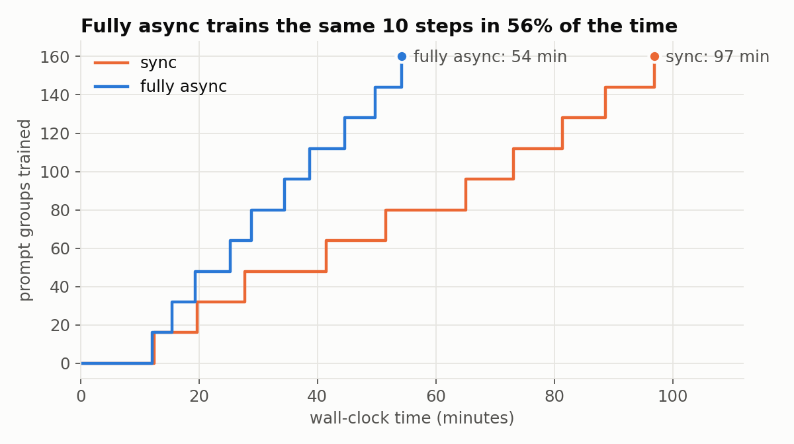
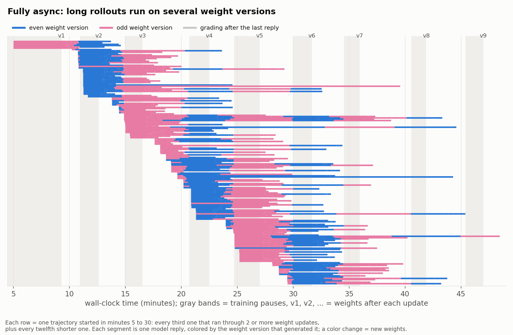
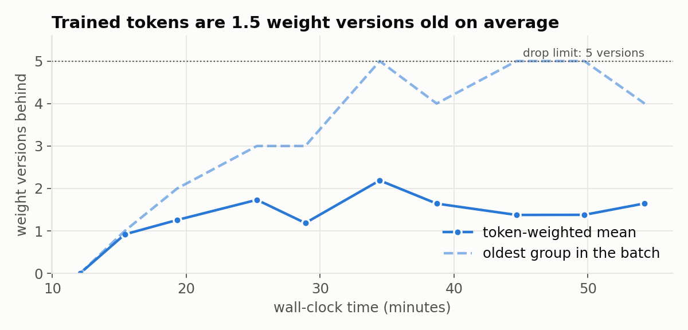
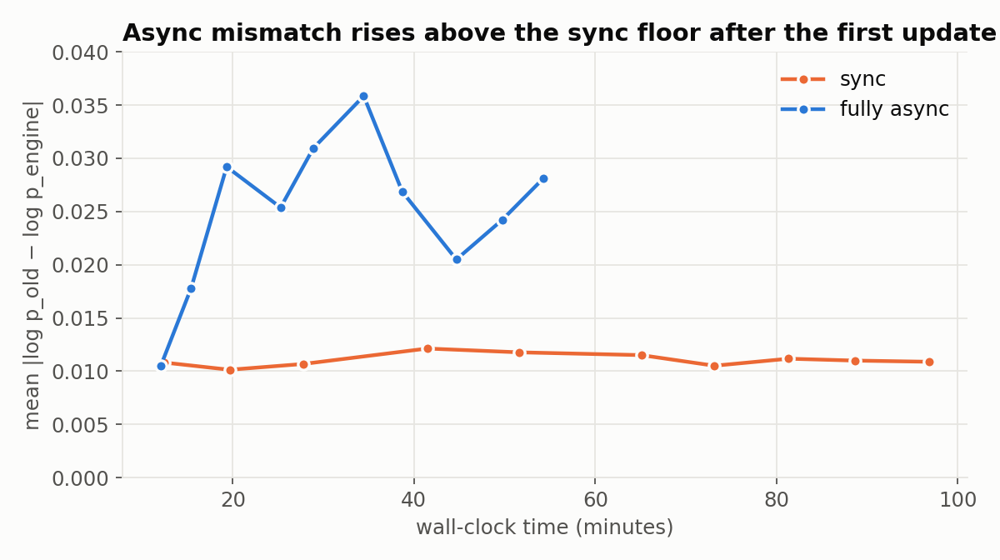
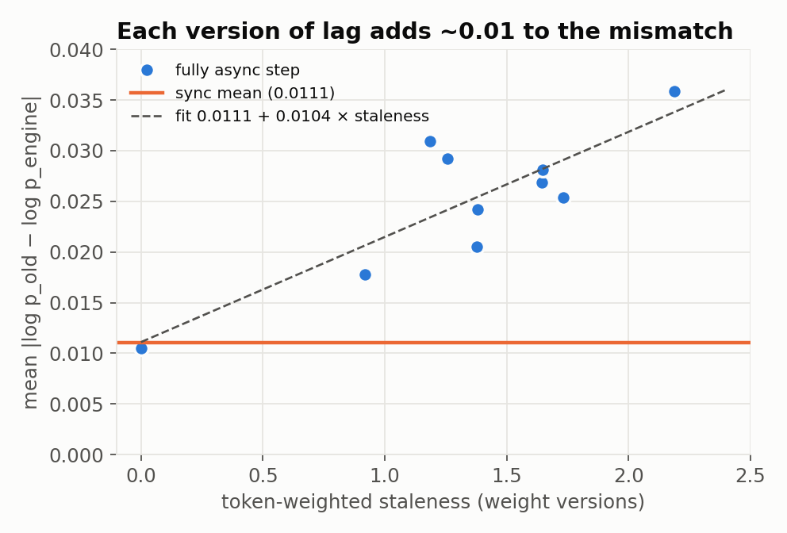
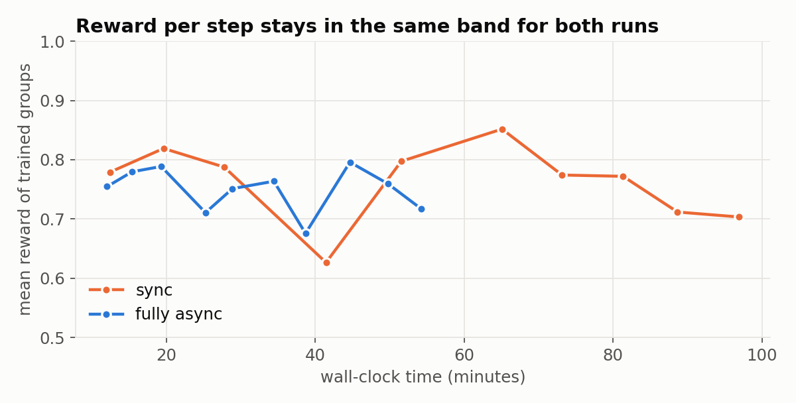
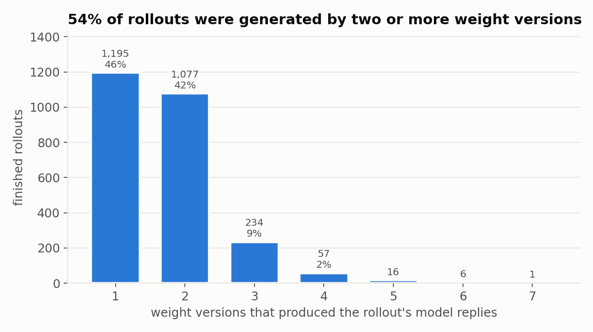

# Fully async vs sync: charts from two 10-step runs

Qwen3.8-27B, GRPO on [EnterpriseOps-Gym](https://huggingface.co/datasets/ServiceNow-AI/EnterpriseOps-Gym)
(649 public tasks, MCP tools), 4 nodes × 8 NVIDIA B300, trainer and SGLang engines on the same GPUs.
16 prompt groups × 8 samples per step. The runs differ only in scheduling: sync, or
`--fully-async --colocate` with `--max-weight-staleness 5` and `--use-tis`. How the mode works is in
[the parent page](../README.md).

*Figure 1. Fully async trained 10 steps in 54 minutes, sync in 97. Excluding the first step (kernel
compilation in both runs): 205 vs 102 prompt groups per hour.*

*Figure 2. Fully async: one row per trajectory; each segment is one model reply, colored by the weight version that generated it (alternating blue and pink, labels v1 to v9 at each update). Gray bands are training pauses. A color change inside a row means the rollout continued on new weights. 78% of finished episodes were alive across at least one weight update; the longest across 7.*

*Figure 3. Trained tokens were 1.5 weight versions old on average (token-weighted, steps 2 to 10). The
oldest group in a batch reached the limit of 5; 3 groups were dropped for exceeding it.*

*Figure 4. Mean |log p_old − log p_engine| per step, where p_engine is SGLang's probability for each
sampled token and p_old the trainer's before the update. Sync stays at 0.010 to 0.012; fully async rises
after the first weight update.*

*Figure 5. Per fully async step, the mismatch grows linearly with staleness: 0.0111 + 0.0104 × staleness
(R² 0.71). The intercept equals the sync mean, so staleness explains the whole async excess.*

*Figure 6. Mean reward of the trained groups per step: 0.762 (sync) and 0.750 (fully async) over 10
steps, no trend in either. Ten steps measure throughput and correctness, not learning quality.*

*Figure 7. Weight versions that produced each finished rollout's model replies (2,586 rollouts): 54% used two
or more, at most 7. A reply that was generating during a pause counts under the version it finished on.
This is lower than Figure 2's 78%, which also counts updates that landed before the first reply or during
grading.*
