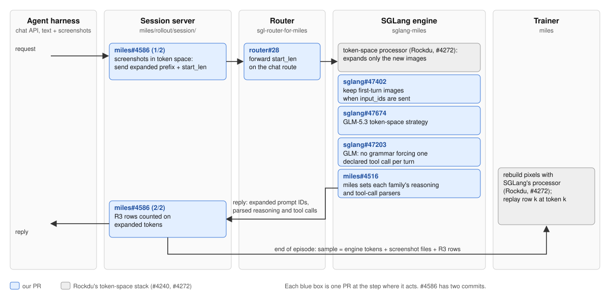

# Our PRs to miles and SGLang

We train vision models with RL on long computer-use episodes. miles ([radixark/miles](https://github.com/radixark/miles)) trains, SGLang ([sgl-project/sglang](https://github.com/sgl-project/sglang)) generates the episodes. These are the fixes we carry and send upstream.

**State on 2026-11-01.** 16 PRs are open upstream: 11 on miles, 4 on SGLang, 1 on the router. Each PR's description has a "Verified on GPU" section with the numbers. GPU runs: Qwen3.8-VL on 4 nodes and GLM-5.3 on 6 nodes of 8x B300, computer-use episodes with screenshots through the TITO session server. Our branches are on the forks [dzorlu/miles](https://github.com/dzorlu/miles), [dzorlu/sglang](https://github.com/dzorlu/sglang) and [dzorlu/sgl-router-for-miles](https://github.com/dzorlu/sgl-router-for-miles).

Table 1. Open PRs by group (the groups are sections 1 to 7 below): what each fixes, its GPU result and whether it merges cleanly today.

| Group | PR | Fixes | GPU result | Merges cleanly |
|---|---|---|---|---|
| 1. TITO | [miles#4586](https://github.com/radixark/miles/pull/4586) | screenshots through the session server on Rockdu's token space, plus R3 offsets on expanded tokens (section 1) | PASS (Qwen3.8-VL, 3 steps; GLM-5.3, 3 steps, R3 aligned, reference KL 0 at step 0) | yes, onto Rockdu's branch; merges after his #4272 |
| 1. TITO | [sgl-router-for-miles#28](https://github.com/radixark/sgl-router-for-miles/pull/28) | router dropped `mm_token_expansion_start_len` on chat | PASS (every token-space run) | yes |
| 1. TITO | [sglang#47402](https://github.com/sgl-project/sglang/pull/47402) | first-turn images dropped with token IDs | PASS (0 prompt-ID mismatches) | no: merge current `sglang-miles` |
| 1. TITO | [sglang#47674](https://github.com/sgl-project/sglang/pull/47674) | GLM-5.3 token-space strategy | PASS (GLM-5.3, 3 steps); CPU parity bitwise | no: merge current `sglang-miles` |
| 1. TITO | [miles#4516](https://github.com/radixark/miles/pull/4516) | Qwen reasoning and tool-call parsers | PASS (100% of 25,461 turns parsed) | yes |
| 1. TITO | [sglang#47203](https://github.com/sgl-project/sglang/pull/47203) | GLM tool-call grammar forced one call per turn | PASS on the non-token-space path (46 calls per turn); not exercised on token space | yes |
| 2. Vision training | [miles#4050](https://github.com/radixark/miles/pull/4050) | loss divided by samples, not episodes, with screenshot folding | PASS (Megatron and torchtitan) | yes |
| 2. Vision training | [miles#4049](https://github.com/radixark/miles/pull/4049) | frozen vision tower not re-sent to engines | PASS on sending (333 tensors per sync); engine-side equality not checked | yes |
| 3. Expert replay (R3) on GLM | [miles#4520](https://github.com/radixark/miles/pull/4520) | R3 on torchtitan: guard crash; reference picked its own experts | PASS (step-0 reference KL exactly 0, both paths) | no: 1 file (`torchtitan_utils/actor.py`) conflicts with main's torchtitan v0.4.0 update (#4537) |
| 4. GLM-5.3 on torchtitan | [miles#4588](https://github.com/radixark/miles/pull/4588) | GLM-5.3 vision tower in torchtitan training | PASS (both GLM paths) | no: 6 files conflict with main's torchtitan v0.4.0 update and GLM-5.3 rewrite (#4537, #4539); needs porting |
| 4. GLM-5.3 on torchtitan | [miles#4522](https://github.com/radixark/miles/pull/4522) | torchtitan resume failed on never-trained parameters | PASS (GLM resume continued at rollout 3, saved) | no: 1 file (`torchtitan_utils/components.py`) conflicts with main's torchtitan v0.4.0 update (#4537) |
| 5. Long colocated runs | [miles#4519](https://github.com/radixark/miles/pull/4519) | offload flush refused with running requests | PASS (sync and fully-async colocated) | yes |
| 5. Long colocated runs | [miles#4521](https://github.com/radixark/miles/pull/4521) | host memory grew every step | PASS per process; per-node totals not logged | yes |
| 6. Native LoRA | [miles#4523](https://github.com/radixark/miles/pull/4523) | native LoRA resume silently restarted | PASS (optimizer, adapter, scheduler bitwise) | no: upstream #4530 merged the scheduler part; drop it |
| 6. Native LoRA | [miles#4524](https://github.com/radixark/miles/pull/4524) | Muse import needed a GPU | PASS; **ready for review** | yes |
| 7. Cancelled episodes | [miles#4518](https://github.com/radixark/miles/pull/4518) | eval crashed on groups with a cancelled episode | not exercised (case never occurred); CPU tests | yes |

Closed: #4546 and #4547 (replaced by #4586). To close: [sglang#47400](https://github.com/sgl-project/sglang/pull/47400) (replaced by the token-space path).

## Taking over: re-verification on torchtitan v0.4.0 (state 2026-11-01)

Upstream merged torchtitan v0.4.0 ([#4537](https://github.com/radixark/miles/pull/4537) to [#4539](https://github.com/radixark/miles/pull/4539)) and [#4530](https://github.com/radixark/miles/pull/4530) on 2026-10-31, and force-updated `sglang-miles` on 2026-11-01. Six PRs conflicted. Each is resolved on a public branch that contains the PR's current head, so adopting it is a fast-forward (no force-push): `git push https://github.com/dzorlu/<repo>.git <resolved-branch>:<pr-branch>`. Adopt a branch once its tests in Table 2 pass.

*Table 2. Resolved branches, not yet adopted by the PRs.*

| PR | PR branch | Resolved branch (head) | What changed | Tests to run |
|---|---|---|---|---|
| [#4520](https://github.com/radixark/miles/pull/4520) | `pr-expert-replay-torchtitan-v2` | `v040-4520` (`bde5a4e06`) | one line: main renamed `checkpointer.load()` to `engine.load_checkpoint()`; our replay install follows it | `tests/fast-gpu/test_torchtitan_routing_replay.py` (1 GPU), `tests/fast/backends/training_utils/test_torch_native_actor.py` |
| [#4522](https://github.com/radixark/miles/pull/4522) | `pr-torchtitan-resume-load-v2` | `v040-4522` (`ca11fec39`) | narrowing moved into v0.4.0's `TiedCheckpointManager._load_checkpoint`. On v0.4.0 every save holds optimizer state for all trainable parameters (`torchtitan/components/optim/utils.py:41-48`), so the PR now only matters when resuming a save made with torchtitan v0.3.0 | `tests/fast/backends/torchtitan_utils/test_checkpoint_resume_state.py` (3 passed locally; fails without the fix), `tests/fast/backends/megatron_utils/test_checkpoint_request_backend_boundaries.py` |
| [#4523](https://github.com/radixark/miles/pull/4523) | `pr-native-lora-resume` | `v040-4523` (`f1916936b`) | main now restores the adapter, scheduler and iteration itself (#4530 and its adapter restore); left: keep the optimizer on for a native LoRA resume, and find the newest `iter_*/adapter` save when `--lora-adapter-path` is not given | `tests/fast/backends/megatron_utils/test_megatron_config.py`, `tests/fast/backends/megatron_utils/test_model_initialize.py` (need Megatron) |
| [#4588](https://github.com/radixark/miles/pull/4588) | `glm-vision-titan-port` | `v040-4588` (`1e553b3d4`) | ported onto main's rewritten GLM-5.3 model (6 files); new `preprocess_inputs` override keeps image tensors out of v0.4.0's per-rank input sharding (every rank needs all images) | `tests/fast/backends/test_torchtitan_glm5_next.py` (needs `fla`, Linux), `test_torchtitan.py`, `test_torchtitan_image_embeddings.py`, `test_torchtitan_cp_log_probs.py`, `test_torchtitan_ref_model.py`, `tests/fast/miles_plugins/models/glm5_next/test_glm5_next_vision.py`, `tests/fast/backends/training_utils/test_multimodal_per_microbatch.py`, `tests/fast/utils/tracking_utils/test_tracking_log_numpy.py` (47 passed locally on CPU; the GLM model tests not yet) |
| [sglang#47402](https://github.com/sgl-project/sglang/pull/47402) | `pr4-qwen-vl-input-ids-v2` | `v040-47402` (`f54f32730c`) | merge of the force-updated `sglang-miles` `fe89fc7a3d`; the PR's diff is its own 7 files again | `test/registered/unit/entrypoints/openai/test_serving_chat.py`, `test/unit/multimodal/test_load_mm_data_by_ids.py`; compare with the same tests on plain `sglang-miles` |
| [sglang#47674](https://github.com/sgl-project/sglang/pull/47674) | `tito-token-space-glm5` | `v040-47674` (`41083b57f9`) | same; its diff is its own 5 files | `test/registered/unit/multimodal/test_glm5_next_token_space.py`, `test/registered/unit/multimodal/test_mm_token_expansion.py` |

Run the miles tests inside `radixark/miles:dev-202611011509` (or newer; torchtitan v0.4.0, torch 2.14) with the branch installed: `pip install --no-deps -e .`, then `python -m pytest -q -o addopts="" <files>`. Run the SGLang tests in a current `radixark/miles:dev` image after checking out the branch in `/sgl-workspace/sglang`.

**GPU checks still owed on v0.4.0.** Build from the combined branches: miles [`verify-int-20261101`](https://github.com/dzorlu/miles/tree/verify-int-20261101) (`c11c2a2ef1`: main `286634cc6` + Rockdu's #4240/#4272 + #4586 + every open miles PR above, resolved; launch-snapshot test fixtures kept from main) and SGLang [`verify-sgl-ts-glm-20261101b`](https://github.com/dzorlu/sglang/tree/verify-sgl-ts-glm-20261101b) (`a05534626f`: `sglang-miles` `b0ed761650` + #47402 + #47674 + #47203), on `radixark/miles:dev-202611011509` (its `sglang-miles` is `b0ed761650`), plus the router fix #28. GLM-5.3 run shape and flags: [../miles-harness/recipes.md](../miles-harness/recipes.md) section 3 (torchtitan 256K row, 6 nodes) with the token-space flags of [../miles-harness/README.md](../miles-harness/README.md) section 6, `--ci-test`, `MILES_TEST_R3_THRESHOLD=1.0`.

1. **Fresh run, 3 steps.** Pass: KL to the reference exactly 0 at step 0 (#4520); screenshots train through the vision tower with no error, three checkpoints (#4588); TITO mismatch 0.0 and 0 prompt-ID mismatches (#4586 on v0.4.0).
2. **Resume of that run for one more step** (`--num-rollout 4`, `--load` its checkpoints, `--ci-disable-weight-update-checker`; that check expects base weights at the first sync). Pass: continues at rollout 3, saves a checkpoint.
3. **Resume of a torchtitan v0.3.0 save on v0.4.0** (any GLM checkpoint saved before 2026-10-31). Pass: the load succeeds and logs which parameters' optimizer state starts fresh (#4522). If it fails on the changed checkpoint layout instead, #4522 has no case left on v0.4.0 and can be closed.

On 2026-11-01 runs 1 and 3 and both unit-test jobs were submitted to our cluster and queued behind other work; results are added here if they finish. After they pass: adopt the six branches, update the six PR descriptions, then mark the passing PRs ready.

**What is left.**
1. Finish the torchtitan v0.4.0 re-verification and adopt the six resolved branches (section "Taking over" above).
2. Mark the passing PRs ready for review; close [sglang#47400](https://github.com/sgl-project/sglang/pull/47400).
3. Coordinate with overlapping upstream PRs (not posted): [#1585](https://github.com/radixark/miles/pull/1585) duplicates #4519; [#4218](https://github.com/radixark/miles/pull/4218) touches #4520's replay guard; [#3879](https://github.com/radixark/miles/pull/3879) would remove #4522's indexer case.
4. Follow-ups: an image-aware threshold for miles' R3 replay check (image tokens disagree about 15 times more than text on both image paths); two upstream bugs to report: native LoRA with `--colocate --lora-train-only` crashes in the first weight update on main, and the B300 dev image cannot train head-dim-256 attention (pin flash-attn-4 4.0.0b19 and quack-kernels 0.6.4).

How to build and run these checks without our launcher: [../miles-harness/](../miles-harness/README.md).

## 1. Exact tokens for vision models (TITO)

TITO (token-in, token-out) means the trainer scores exactly the token IDs and images the engine used, on every turn of an agent episode. With the PRs below, Qwen3.8-VL and GLM-5.3 each trained 3 steps on computer-use episodes with screenshots through the session server: TITO mismatch rate 0.0, 0 prompt-ID mismatches, and on GLM the routed-expert replay stays aligned with images. Figure 1 shows where each PR acts on one chat turn.

*Figure 1. One chat turn through the session server and the PR that acts at each step. Grey boxes are Rockdu's token-space stack ([#4240](https://github.com/radixark/miles/pull/4240), [#4272](https://github.com/radixark/miles/pull/4272)), which these PRs build on.*

*Table 3. The TITO PRs. GPU runs: Qwen3.8-VL (Megatron, 4 nodes) and GLM-5.3 (torchtitan, 6 nodes) of 8x B300, episodes up to 256 turns with screenshot folding.*

| PR | What broke | Fix | GPU result |
|---|---|---|---|
| [miles#4586](https://github.com/radixark/miles/pull/4586), commit 1 | the session server carried no screenshots on the token-space design | send the stored expanded prefix, the new part with one placeholder per image, and `mm_token_expansion_start_len`; store the engine's expanded IDs | Qwen and GLM 3 steps each; TITO mismatch 0.0 |
| [miles#4586](https://github.com/radixark/miles/pull/4586), commit 2 | R3 row offsets counted one placeholder per image, so rows fell out of line (HTTP 422) | count offsets on the expanded tokens | GLM image-token replay rate equal to the non-token-space path (0.659% vs 0.638%) |
| [sgl-router-for-miles#28](https://github.com/radixark/sgl-router-for-miles/pull/28) | the router dropped `mm_token_expansion_start_len` on chat; turn 2 of every session failed | forward the field | every token-space run |
| [sglang#47402](https://github.com/sgl-project/sglang/pull/47402) | a chat request with `input_ids` and start 0 dropped its images | keep them | 0 prompt-ID mismatches over 124 Qwen samples |
| [sglang#47674](https://github.com/sgl-project/sglang/pull/47674) | no GLM-5.3 strategy for the token-space processor | add one, bitwise equal to SGLang's GLM processor | GLM 3 steps and a resume |
| [miles#4516](https://github.com/radixark/miles/pull/4516) | miles never set SGLang's parsers; for Qwen whole replies were stored as text | pass each model family's reasoning and tool-call parsers | 100% of 25,461 Qwen turns parsed; 0 leaked `</think>` |
| [sglang#47203](https://github.com/sgl-project/sglang/pull/47203) | SGLang's GLM parser forced one declared tool call per turn | `--tool-call-constraint none` | up to 46 tool calls per turn (non-token-space GLM path) |

Merge order: Rockdu's #4240 and #4272, then #4586 (based on his branch). #47402 and #47674 go into `sglang-miles`, #47203 into SGLang main, #28 into the router's main, #4516 into miles main. Rockdu confirmed (2026-11-01) that his unpublished [4/4] covers basic full-modality support and essential TITO capability and does not overlap much with #4586. Replaced and closed: #4546 and #4547; [sglang#47400](https://github.com/sgl-project/sglang/pull/47400) is to be closed. Design and worked examples: [tito-token-space.md](tito-token-space.md).

## 2. Vision training correctness

- **[miles#4050](https://github.com/radixark/miles/pull/4050).** Screenshot folding splits one episode into several training samples. The loss was divided by samples instead of episodes, so it came out 8.7 times too small on Qwen at step 1.
- **[miles#4049](https://github.com/radixark/miles/pull/4049).** With the vision tower frozen, miles did not re-send its weights to the engines after an update. `--mm-tower-sync` now does this for any model.

## 3. Expert replay (R3) on GLM

Training must use the same experts the engine picked.

- **[miles#4520](https://github.com/radixark/miles/pull/4520).** A safety check crashed on the first pass, and the reference model picked its own experts, so step-0 KL was 0.0096 instead of 0.
- **[miles#4547](https://github.com/radixark/miles/pull/4547)** (replaces #4517). Through the session server, R3 counted positions without expanding screenshots. It now counts the way the engine does, in the output store too. Builds on #4546.

## 4. GLM-5.3 on torchtitan

- **[miles#4588](https://github.com/radixark/miles/pull/4588): vision tower in training.** Port of our closed #4022 onto main after upstream merged GLM-5.3 text training on torchtitan (#3989, #3995). Images go through the frozen vision tower; log-probs are computed on each CP rank's own tokens.
- **[miles#4522](https://github.com/radixark/miles/pull/4522).** Parameters that never train (GLM's attention indexer) had no saved optimizer state, so a resume failed. They now start fresh. The other resume bug, a silent restart from the base model, no longer happens on main.

## 5. Long colocated runs

Training and generation share the same GPUs.

- **[miles#4519](https://github.com/radixark/miles/pull/4519).** Freeing engine memory crashed while a request was still running. All requests are now cancelled first.
- **[miles#4521](https://github.com/radixark/miles/pull/4521).** Logs each process's GPU memory and returns host memory after each step. Without it, host memory grew about 115 GiB per node per step.

## 6. Native LoRA

- **[miles#4523](https://github.com/radixark/miles/pull/4523).** A native-LoRA resume dropped the saved Adam state and stepped the learning-rate schedule twice. Found on Muse Spark; the fix applies to every native-LoRA model.
- **[miles#4524](https://github.com/radixark/miles/pull/4524).** Importing miles failed on a machine without a GPU once Muse support was in. Targets upstream's `muse-spark-open` branch.

Muse's merged-weight LoRA sync is not raised by us: upstream's own [#4211](https://github.com/radixark/miles/pull/4211) does the same.

## 7. Cancelled episodes

- **[miles#4518](https://github.com/radixark/miles/pull/4518).** Scoring crashed on a group with a cancelled episode. It now skips such groups.
