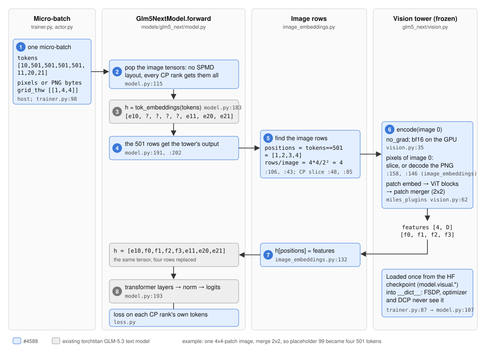

# GLM-5.3 screenshots in torchtitan training (#4588)

State on 2026-11-11.

torchtitan is the trainer. Upstream's torchtitan port of GLM-5.3 (`miles/backends/torchtitan_utils/models/glm5_next/`)
is the text model only: an image token got the placeholder's embedding, nothing from the screenshot.
[#4588](https://github.com/radixark/miles/pull/4588) adds the vision tower, frozen, and writes its output into the
token embeddings. Figure 1 is one micro-batch's forward pass.

*Figure 1. One micro-batch with one image through the torchtitan GLM-5.3 forward. Blue is #4588; grey is the existing text
model. File and line references are on the dzorlu/miles branch `glm-vision-titan-port`.*

Table 1. The modules.

| Module | File | Role |
|---|---|---|
| `Glm5NextModel.preprocess_inputs` | `models/glm5_next/model.py:115` | Keeps the image tensors out of the SPMD layout; every CP rank gets all images of the sequence |
| `Glm5NextModel.attach_vision_tower` | `model.py:107`, called from `trainer.py:87` | Loads the tower once from the HF checkpoint (`model.visual.*`) into `__dict__`, on the stage that embeds tokens |
| `write_image_features` | `image_embeddings.py:106` | Finds the image rows (`tokens == image_token_id`), counts rows per image (`grid.prod() / merge²`), writes the features in with `index_put` |
| `image_features_for_local_tokens` | `image_embeddings.py:85` | Under context parallelism: this rank's slice of the rows, and only the images it holds are encoded |
| `select_pixel_values` | `image_embeddings.py:158` | One image's pixels: a slice of the batch's `pixel_values`, or the PNG decoded with the engine's processor |
| `Glm5NextImageEncoder.encode` | `models/glm5_next/vision.py:35` | `no_grad`, bf16 on the GPU: pixels → `Glm5NextVisionModel` → one feature row per merged patch |
| `Glm5NextVisionModel` | `miles_plugins/models/glm5_next/vision.py:62` | The tower: patch embedding, ViT blocks, 2×2 patch merger (the same module SGLang runs) |
| loss | `loss.py` | Log-probs on each CP rank's own tokens, since the logits are sharded under CP |

Frozen means forward only: no gradient, no optimizer state, no stored activations for the tower. Backward stops at the
`index_put`. Kept out of `nn.Module` children, the tower is never sharded by FSDP, stepped by the optimizer or written to
a checkpoint; `--mm-tower-sync` ([#4049](https://github.com/radixark/miles/pull/4049)) also keeps it out of the weight sync.

With `--multimodal-token-space-processing` the batch's `pixel_values` come from `compute_multimodal_train_inputs`, the same
processor code the engine ran on the same files, so the trainer's pixels equal the engine's. The flag accepts the torchtitan
backend with this PR (`miles/utils/arguments.py`).
