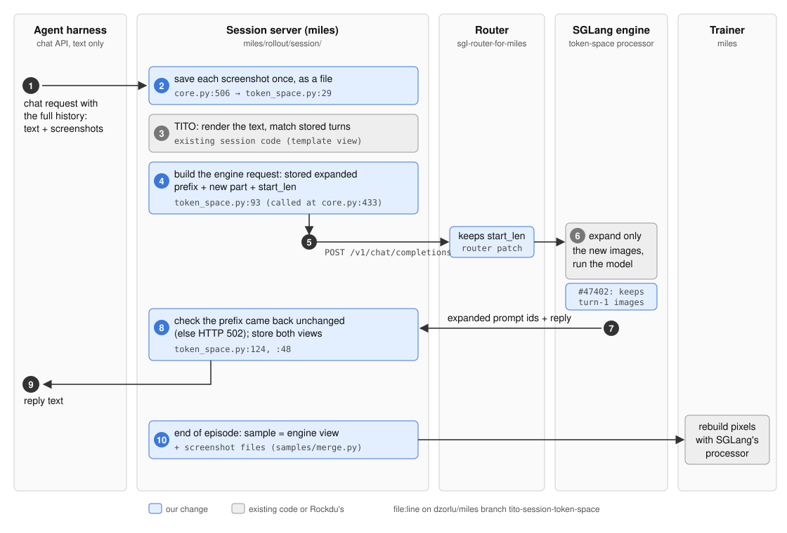
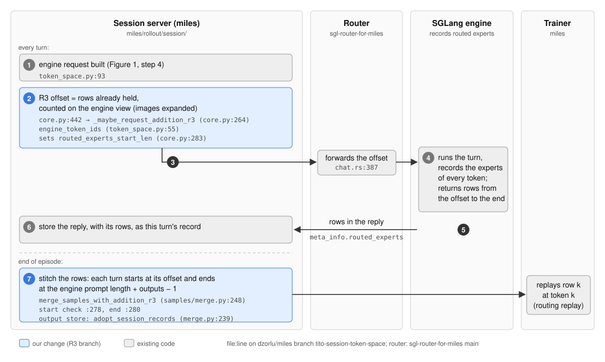
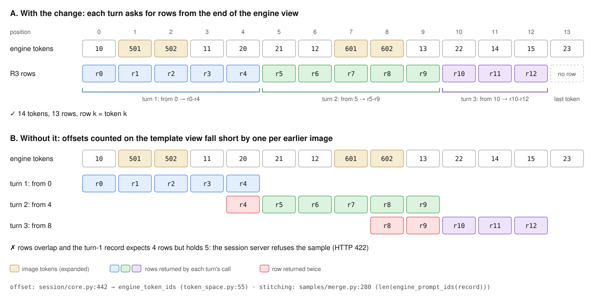

# Screenshots through the TITO session server: what we propose

State on 2026-11-11.

## 1. The problem

**TITO** ("token in, token out") means the trainer scores the exact token IDs the engine ran, never a re-tokenization of text. In our agent runs the **session server** (`miles/rollout/session/`) enforces it. An outside harness (our environment harness, Claude Code style agents) drives the episode over the OpenAI chat API and resends the whole conversation as text every turn. The session server maps that text back onto the token IDs it stored for earlier turns.

A screenshot is one placeholder token in the chat text but hundreds of tokens in the forward pass: 336 for a 768x432 screenshot on Qwen3.8. The engine expands the placeholder to run the model. The trainer must see the same expanded tokens and the same pixel values.

The examples below use made-up token IDs:

```
10, 11, 12, 13   ordinary text tokens
99               the image placeholder
501 502          screenshot A after expansion (2 tokens here; hundreds in reality)
601 602          screenshot B after expansion
20 21 / 22       the model's replies r1 / r2
```

## 2. Two ways to run an episode

| | Generate path | Session-server path |
|---|---|---|
| Who owns the loop | miles or launcher code | an outside agent harness |
| Code | `miles/rollout/sglang_rollout.py`, `generate_hub/single_turn.py`, `generate_utils/generate_endpoint_utils.py` | `miles/rollout/session/` (server.py, core.py, v2/), reached through `generate_hub/agentic_tool_call.py` with `--use-session-server` |
| Engine endpoint | `/generate`, images passed explicitly | the chat endpoint, `input_ids` plus the messages |
| How TITO holds | automatic: token IDs never become text | the session server re-maps the harness's text onto stored IDs |
| Our runs | only payloads without `--session-server` | every agent training run (text and computer use, verification) |

## 3. Rockdu's design ("token space")

Rockdu's design is on `main`: [#4240](https://github.com/radixark/miles/pull/4240) sends media refs to SGLang, [#4272](https://github.com/radixark/miles/pull/4272) builds training inputs in token space. Open on top of it: [#4610](https://github.com/radixark/miles/pull/4610) (Qwen3.5 multimodal under raw Megatron), [#4633](https://github.com/radixark/miles/pull/4633) (TimeLens video), [#4651](https://github.com/radixark/miles/pull/4651) (the trainer reuses the engines' feature cache). The SGLang half (the token-space processor, a Qwen VL strategy) is in `sglang-miles` behind `--enable-token-space-processor`. The miles flag is `--multimodal-token-space-processing`.

The idea: the engine expands placeholders and returns the expanded token IDs. miles stores what the engine ran. The trainer rebuilds pixel values with the same SGLang processor code on the same image files.

```
 miles: sglang_rollout.generate()                       sglang_rollout.py:153
   token_space = has_media(...) and --multimodal-token-space-processing   :171
   images -> /media/<sha256>.png, written once          media_refs.py:73, :142
   payload += mm_token_expansion_start_len, return_prompt_token_ids
                                                        generate_endpoint_utils.py:65-69, used at :240

 TURN 1  input_ids [10, 99, 11]   media [A]   start_len 0  ──►  SGLang: keep the first 0 ids,
                                                                expand 99 -> 501 502
         ◄── prompt_token_ids [10, 501, 502, 11] + reply [20, 21]
         adopt_expanded_prompt_ids(): sample.tokens = [10,501,502,11,20,21]
                                                        generate_endpoint_utils.py:72, called at :245
 TURN 2  input_ids [10,501,502,11,20,21 | 12, 99, 13]   media [A, B]   start_len 6
                                                         ──►  keep the first 6, expand the new 99
         ◄── prompt_token_ids [10,501,502,11,20,21,12,601,602,13] + reply [22]

 TRAINER rollout.py:76 -> compute_multimodal_train_inputs()   token_space_media_process.py:59
         -> _trainer_processor(): strategy_for(hf_config) (Qwen VL only), SGLang's
            TokenSpaceProcessor on A.png, B.png -> pixel values  :95-129
```

`start_len` tells SGLang which tokens are already expanded, so earlier turns are never re-expanded or re-tokenized.

**What it does not cover.** #4272 changes no file under `miles/rollout/session/`, and its description does not mention the session server. With the flag on, a screenshot sent through the session server reaches the engine as a bare placeholder with no image. There is no GLM-5.3 strategy and no R3 support.

## 4. What we add

```
 miles, base main:
   OURS 1: session server on token space              (#4770)
   OURS 2: R3 rows on the engine view                 (#4770)
 SGLang, base sglang-miles:
   OURS 3: first-turn images on the chat endpoint     (#47402)
   OURS 4: GLM-5.3 token-space strategy               (#47674)
 router (sgl-router-for-miles):
   OURS 5: forward mm_token_expansion_start_len on chat (#28)
```

Table 1. The five changes. Changes 1 and 2 are one PR, #4770: change 2 only matters once change 1 sends images through the session server.

| # | Repo | Change | Branch, head | Size |
|---|---|---|---|---|
| 1 | miles | Session server on token space | [#4770](https://github.com/radixark/miles/pull/4770) | 11 files, +278/-24; new `session/token_space.py` (143 lines) |
| 2 | miles | R3 rows on the engine view | [#4770](https://github.com/radixark/miles/pull/4770), head `196b1a1f8` | 4 code files, about 25 lines; +185 test lines |
| 3 | SGLang | Keep first-turn images | [sglang#47402](https://github.com/sgl-project/sglang/pull/47402), `pr4-qwen-vl-input-ids-v2` `008518e4fe` | one condition plus a test |
| 4 | SGLang | GLM-5.3 strategy | [sglang#47674](https://github.com/sgl-project/sglang/pull/47674), `354d92b34f` | new `models/glm5_next.py`, a 2-line hook, tests |
| 5 | router | Forward `mm_token_expansion_start_len` on the chat route | [sgl-router-for-miles#28](https://github.com/radixark/sgl-router-for-miles/pull/28), `deb98e1` | 3 files, +34 lines with tests |

### 4.1 The session server on token space

Figure 1 shows one turn through the session server. Blue boxes are our change; grey boxes are existing code or Rockdu's.



*Figure 1. One chat turn with screenshots through the session server. File and line references are on the dzorlu/miles branch `tito-session-token-space`.*

Table 2 follows the made-up token IDs from section 1 through two turns. Step numbers refer to Figure 1.

*Table 2. Token flow for a two-turn episode. Turn 1 has screenshot A; turn 2 adds a tool result and screenshot B.*

| | Turn 1 | Turn 2 |
|---|---|---|
| Harness sends (step 1) | user "hi" + screenshot A | the whole history + a tool result + screenshot B |
| Template view (step 3) | `[10, 99, 11]` | `[10, 99, 11, 20, 21, 12, 99, 13]` |
| Prefix match (step 3) | nothing stored yet | first 5 tokens match the stored `[10, 99, 11, 20, 21]` |
| Sent to the engine (step 4) | `[10, 99, 11]`, images `[A]`, `start_len` 0 | `[10, 501, 502, 11, 20, 21, 12, 99, 13]`, images `[A, B]`, `start_len` 6 |
| Engine returns (step 7) | prompt `[10, 501, 502, 11]`, reply `[20, 21]` | prompt `[10, 501, 502, 11, 20, 21, 12, 601, 602, 13]`, reply `[22]` |
| Stored engine view (step 8) | `[10, 501, 502, 11, 20, 21]` | `[10, 501, 502, 11, 20, 21, 12, 601, 602, 13, 22]` |

At the end of the episode (step 10) the training sample is the last engine view plus files A and B. With `--multimodal-token-space-processing` off, a session request with images gets HTTP 400.

**Two views per turn.** The **template view** (one placeholder per image) is what the chat template renders from the harness's text; the TITO prefix check and rollback compare against it, so they are unchanged. The **engine view** (images expanded) is taken from the engine's returned prompt; requests, samples and R3 rows use it. Collapsing expanded tokens back to placeholders is not possible in general: Qwen video expansions contain timestamp text.

### 4.2 R3 rows on the engine view

GLM-5.3 is a mixture-of-experts model. R3 (routing replay) records, during the inference forward pass, which experts the router picked for each token at every MoE layer: one **row** per token. The trainer replays row *k* at token *k* instead of routing again, so row *k* must be token *k*'s recording.

An agent episode is one inference call per turn but one training sequence. The session server stitches the rows: on each turn it asks the engine only for rows after an offset (`routed_experts_start_len`) and appends them. The offset must equal the rows already held, counted as the forward pass ran the tokens, with images expanded.

Figure 2 shows where this happens in the code. Steps 2 and 7 are our change; the rest is existing code.



*Figure 2. The R3 code path: every turn (steps 1 to 6) and the end of the episode (step 7). File and line references are on the dzorlu/miles branch `tito-session-token-space`.*

Figure 3 shows a three-turn episode: screenshot A on turn 1, screenshot B on turn 2, text only on turn 3. Each image expands to 2 tokens here.



*Figure 3. Routed-expert rows for a three-turn episode, built by the real session-server code with a stub engine. A: with change 2. B: without it.*

*Table 3. Offset requested and rows returned per turn. "Template view" counts each image as one placeholder.*

| Turn | Engine prompt + reply | Offset with change 2 | Rows returned | Offset without (template view) | Rows returned |
|---|---|---|---|---|---|
| 1 | `[10, 501, 502, 11]` + `[20, 21]` | 0 | 0 to 4 | 0 | 0 to 4 |
| 2 | `[..., 12, 601, 602, 13]` + `[22]` | 5 | 5 to 9 | 4 | 4 to 9 |
| 3 | `[..., 22, 14, 15]` + `[23]` | 10 | 10 to 12 | 8 | 8 to 12 |

With change 2 the sample has 14 tokens and 13 rows, and row *k* comes from position *k* for every *k*. Without it, each offset falls short by one per earlier image, rows overlap, and the turn-1 record expects 4 rows but holds 5. The session server then refuses the sample with HTTP 422 (`cannot reshape array of size 20 into shape (4,2,2)`); the two-turn episode is refused the same way. Every shape we ran was refused rather than silently misaligned. A shape whose sizes happen to divide evenly could pass the reshape; we have not seen one.

Change 2 computes the offset on the engine view, after the request is built (`engine_token_ids`, `token_space.py:55`, called at `core.py:442` and `v2/core.py:231`). `merge_samples_with_addition_r3` and `adopt_session_records` end each turn's rows at `len(engine_prompt_ids(record)) + outputs - 1` (`samples/merge.py:280`, `:239`).

### 4.3 First-turn images (#47402)

On `sglang-miles` (`a5701d958b`), `serving_chat.py:1484-1495`: when a chat request carries `input_ids`, media are collected from the messages only if `mm_token_expansion_start_len` is non-zero. On the first turn of a session it is 0, so the images are dropped. Rockdu's generate path does not hit this because it posts to `/generate` with the images passed explicitly; the session server uses the chat endpoint.

```
 TURN 1 chat request: input_ids [10, 99, 11], messages [user + imgA], start_len 0
   before: start_len 0 -> image_data = []         -> 99 runs with no image
   #47402: model is multimodal -> collect imgA     -> 99 expands to 501 502
```

#47402 (`serving_chat.py:1494-1498`) collects media when the model is multimodal or the offset is set.

### 4.4 GLM-5.3 strategy

A `glm5_next.py` strategy for the token-space processor: each `<|image|>` expands to `grid.prod() // merge_size**2` copies between `<|begin_of_image|>` and `<|end_of_image|>`; rotary positions via `get_rope_index_glm4v`; a 2-line hook lets a strategy turn on RGB conversion (without it, an RGBA image gives different pixel values than SGLang's existing GLM processor). It needs transformers 5.19.0 or newer, which ships the GLM-5.3 processor. GLM video is not supported on this path.

## 5. Evidence

| Check | Result |
|---|---|
| Changes 1 and 2 on CPU, with SGLang's real Qwen token-space processor and the Qwen3.8 tokenizer, stub engine | 21 tests: bytes sent per turn, sample tokens equal the engine prompt plus reply, trainer pixel values equal the engine's exactly, a reply shared by two folded leaves trains in one of them, a part option is refused on the turn, a v1 retry that fails leaves the session unchanged. 35 passed with `test_media_refs.py` in `radixark/miles:dev-202611101346` ([../miles-harness/modal/](../miles-harness/modal/miles_tests.py)) |
| Session and router suites vs #4272's head | base 1,909 passed; change 1 2,058; change 2 1,941; the same 13 environment failures on all three |
| R3 tests | the 4 R3 tests fail with change 1 alone and pass with change 2 |
| Change 3 | its test fails on sglang-miles and passes on #47402; CPU serving_chat and token-space tests 230 passed vs 229, the same 14 macOS video/audio failures |
| Change 4 parity vs SGLang's existing GLM processor | bitwise equal input_ids, mm_token_type_ids, pixel_values, image_grid_thw and rotary positions, for 1 and 3 images and a 2-turn chat with `start_len` |
| GPU, Qwen3.8-VL (Megatron, 4 nodes of 8x B300), computer-use episodes up to 256 turns with screenshot folding, 3 train steps | 32/32 and 128/128 episodes graded; TITO mismatch rate 0.0; 0 prompt-ID mismatches over 124 samples; 0 HTTP 400; train/rollout KL 8.9e-4 to 9.1e-4 and mean abs log-prob diff about 0.014 per step; 3 checkpoints |
| GPU, GLM-5.3 (torchtitan, 6 nodes, R3 on), same episodes, 3 train steps then a resume for a 4th | 0 prompt-ID mismatches; train/rollout KL 2.45e-3 / 3.06e-3 / 1.69e-3; KL to the reference exactly 0 at step 0; resume continued at rollout 3 and saved its checkpoint |
| GPU, R3 alignment (GLM) | share of tokens whose top-8 experts share none with the replay: image tokens 0.659% vs 0.638% on the non-token-space path, text 0.0445% vs 0.0460%: the same, so the offsets are aligned |

GPU pass criteria: first-turn images reach the engine; `start_len` equals the stored engine view every turn, with no HTTP 502 or 400; each image's expanded length equals `grid.prod() // merge_size**2` for its own grid; samples equal the engine prompt plus reply; the trainer's image build succeeds; step 0 is finite and close to earlier runs (Qwen mean log-prob gap 0.0128, K3 KL 5.2e-4). GLM also: R3 rows equal tokens minus 1, replay mismatch 0, step-0 KL to the reference near 0.

## 6. Open questions for the token-space design

1. Who cleans `--shared-media-dir`? Nothing deletes the files.
2. `main` accepts `--multimodal-token-space-processing` for the Megatron backend only (`arguments.py`), so GLM-5.3 on torchtitan needs #4588 and that check relaxed.
3. The engine's `TokenSpaceProcessor` processes every media item on every request, including images already in the expanded prefix; #4651 caches on the trainer side only.
